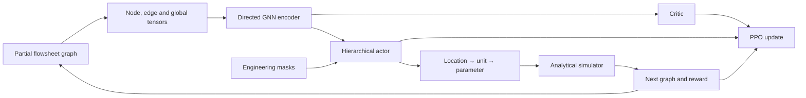
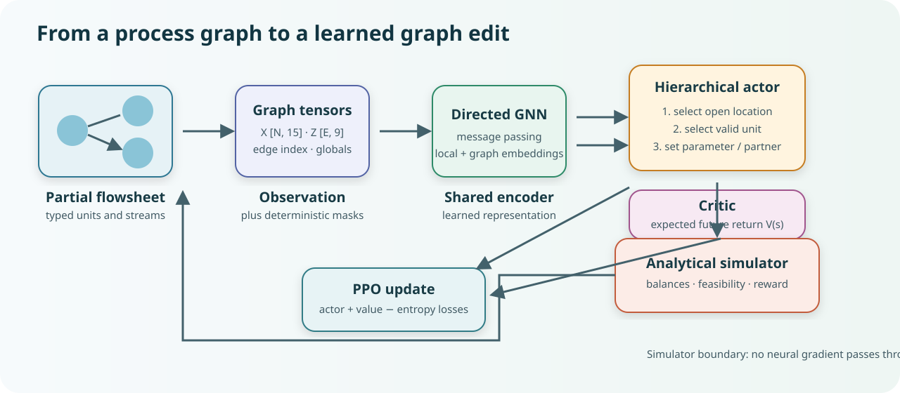
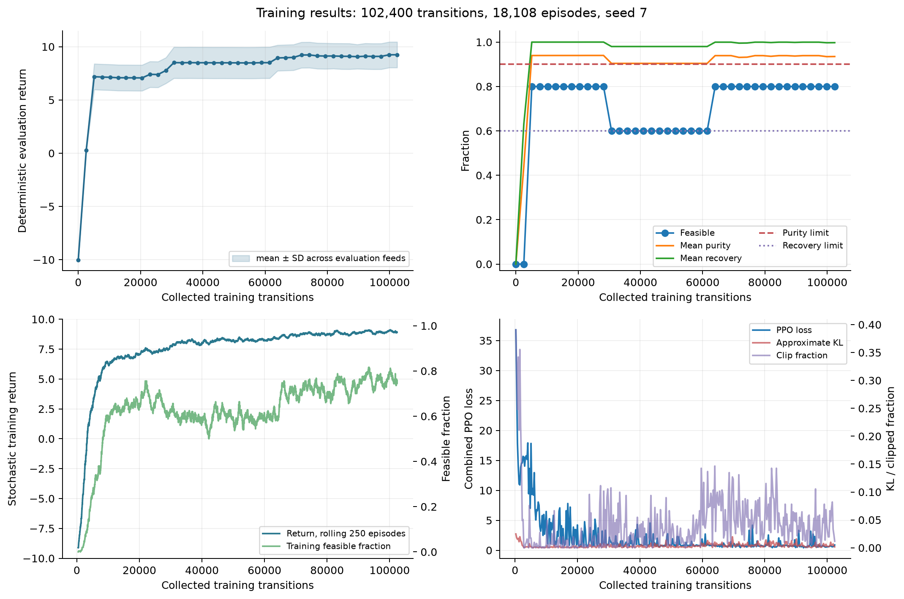
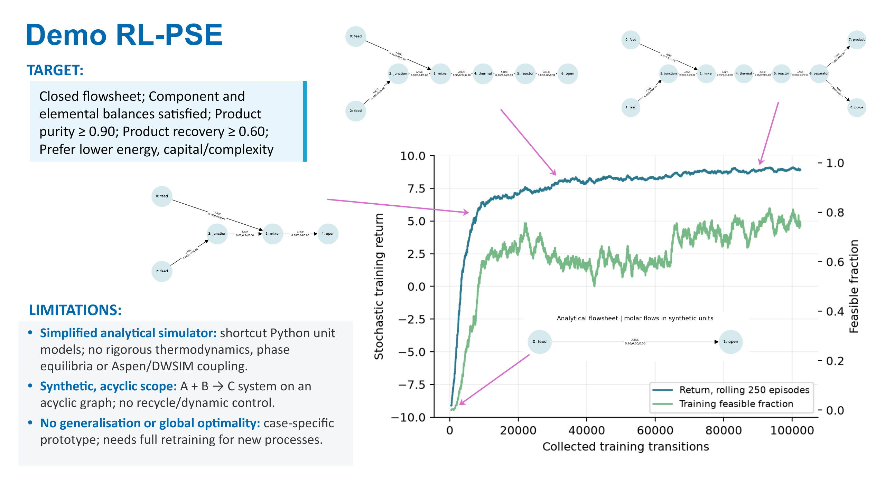

# Flowsheet RL Educational

An executable teaching project for **graph-based process-flowsheet construction with hierarchical reinforcement learning**. A directed flowsheet becomes graph tensors; a GNN encodes the partial design; a hierarchical actor chooses a location, unit operation, and optional continuous parameter; an analytical simulator evaluates the resulting graph; and PPO learns from the reward.

> [!IMPORTANT]
> **Start with the [step-by-step teaching notebook](notebooks/learn_flowsheet_rl_step_by_step.ipynb).** It is the main project tour: it connects equations to source files, builds a flowsheet one action at a time, inspects graph tensors and policy outputs, runs a short learning exercise, and compares it with the recorded long campaign.

[Quick start](#quick-start) · [Run a long campaign](docs/run_model.md) · [Code walkthrough](docs/code_walkthrough.md) · [Results](docs/results.md) · [Literature tutorial](docs/tutorials/gnn_hierarchical_actor_critic.md) · [Introductory slides](assets/slides/RL-PSE-IntroSep.pdf)

## What this project demonstrates

The environment starts with two synthetic feeds for the illustrative reaction `A + B → C`. At each step, the policy edits a directed graph by attaching a mixer, thermal unit, reactor, separator, product, or purge. Deterministic masks remove structurally impossible choices. The simulator then propagates component flows through transparent analytical unit models and evaluates purity, recovery, energy, complexity, and closure.





The implementation separates four responsibilities:

- **Engineering rules and masks** define which graph edits are legal.
- **The analytical simulator** applies explicit unit equations and feasibility checks.
- **The neural policy** chooses among currently valid actions.
- **PPO** updates the GNN, actor, and critic from collected experience; gradients do not pass through the simulator.

## A recorded learning campaign

The included example is a single CPU campaign with 102,400 collected transitions, 18,108 completed episodes, and 400 PPO updates. It first sampled a feasible design at transition 528. Its final deterministic policy met the feasibility criteria in 4 of 5 held-out feed cases, with mean return 9.245. These results show that the software can learn useful behavior in this toy domain; they do not establish generalization, global optimality, or superiority over conventional process synthesis.

| Training behavior | Learning progression and generated flowsheets |
|---|---|
|  |  |

The compact evidence record is under [`examples/long_run`](examples/long_run), including configuration metadata, per-seed evaluation, serialized designs, and plots. Checkpoints and the full step history are intentionally omitted from this mini repository; use the supplied configuration to produce a fresh, fully auditable run.

## Quick start

Requirements: Python 3.11–3.13 and [uv](https://docs.astral.sh/uv/). A CPU is sufficient; no commercial process simulator is required.

```powershell
git clone <your-repository-url>
Set-Location flowsheet-rl-educational
uv sync --locked --extra dev --extra notebook --python 3.13
uv run --extra dev pytest -q
uv run --extra notebook jupyter lab notebooks/learn_flowsheet_rl_step_by_step.ipynb
```

If you already cloned the repository, replace the first two lines with `Set-Location` to your local copy. In VS Code, select `.venv/Scripts/python.exe` as both the Python interpreter and notebook kernel after `uv sync`.

Run a small command-line experiment:

```powershell
uv run python scripts/run_baselines.py --out runs/baselines_demo
uv run python scripts/train.py --config configs/train.yaml --out runs/train_demo
uv run python scripts/evaluate.py --checkpoint runs/train_demo/checkpoint.pt --out runs/evaluate_demo
```

For a 102,400-transition campaign like the recorded example:

```powershell
uv run python scripts/train.py --config configs/train_long.yaml --out runs/my_long_run
uv run python scripts/plot_training_results.py --run runs/my_long_run
```

See the [complete run guide](docs/run_model.md) for notebook execution, background campaigns, monitoring, checkpoint continuation, and transfer experiments.

## Learning path

1. **[Step-by-step notebook](notebooks/learn_flowsheet_rl_step_by_step.ipynb)** — the recommended entry point.
2. **[Beginner code walkthrough](docs/code_walkthrough.md)** — every block, class, equation, and file in reading order.
3. **[Architecture](docs/architecture.md)** and **[model specification](docs/model_specification.md)** — graph dimensions, policy factorization, unit equations, reward, and constraints.
4. **[Recorded results](docs/results.md)** — explicitly preliminary evidence from the long campaign.
5. **[GNN and hierarchical actor–critic tutorial](docs/tutorials/gnn_hierarchical_actor_critic.md)** — theory with links to primary literature.
6. **[RL and flowsheet fundamentals](docs/tutorials/rl_flowsheet_fundamentals.md)** — introductory Modules 1–2.
7. **[Introductory slide deck](assets/slides/RL-PSE-IntroSep.pdf)** — a visual overview.

## Repository map

```text
configs/                 Environment, network, training, and transfer settings
notebooks/               Compact explorer and the main step-by-step tutorial
src/flowsheet_rl/        Importable environment, simulator, GNN, policy, and PPO
scripts/                 Train, evaluate, inspect, plot, and run campaigns
tests/                   Unit and integration tests
docs/                    Architecture, equations, reports, limitations, references
examples/long_run/       Small evidence bundle from the recorded long campaign
assets/                  Public figures and introductory PDF slides
```

## Scientific scope

This is an educational research prototype with synthetic component data and shortcut unit equations. It has no rigorous thermodynamics, phase equilibrium, recycle convergence, dynamic control, safety model, or Aspen/DWSIM coupling. Its acyclic graph scope and small evaluation set do not support claims of industrial validity or broad generalization. Read [assumptions and limitations](docs/assumptions_and_limitations.md) before interpreting the outputs.

The architecture is inspired by Stops, Leenhouts, Gao, and Schweidtmann, “Flowsheet generation through hierarchical reinforcement learning and graph neural networks,” *AIChE Journal* 69(1), e17938, [doi:10.1002/aic.17938](https://doi.org/10.1002/aic.17938). This repository does not reproduce that paper’s chemical system, simulator, numerical results, or performance claims. The [paper-to-prototype mapping](docs/paper_mapping.md) records similarities and departures, while [references](docs/references.md) tracks the main sources.

## Contributing and citation

Bug reports, teaching improvements, new tests, and carefully scoped simulator extensions are welcome; see [CONTRIBUTING.md](CONTRIBUTING.md). If you reuse this repository, cite it using [`CITATION.cff`](CITATION.cff) and cite the original methods papers relevant to your work. The [publishing checklist](PUBLISHING.md) gives the private-first GitHub release steps.

Released under the [MIT License](LICENSE).
