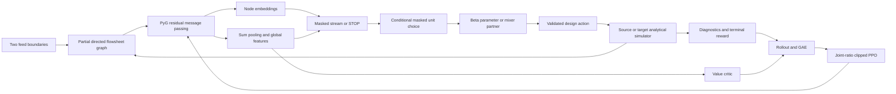

# Computational architecture

## Graph contract

The partial state is G=(V,E,X,Z,g). NetworkX stores the engineering graph.
Nodes: feed, open, mixer, thermal, reactor, separator, product, purge, junction.
An open stream is an edge into an explicit open node. Selecting that node replaces
its type with the chosen unit or sink. A separator creates two new open nodes;
a single-output unit creates one. For a mixer, the second selected open node becomes
a zero-cost junction, and its edge is connected to the chosen mixer. Both selected
nodes were leaves, so this cannot create a cycle. Recycle edges are unsupported;
graph validation rejects cycles. The junction preserves stable IDs without encoding
those IDs as numerical neural features.

Gymnasium observations contain a variable-size `spaces.Graph` GraphInstance plus
global features and bounded masks. There is no padding in neural graph tensors.
Masks are padded only to the configured maximum possible node count:
`max_nodes=4+2*max_units`. Stable internal IDs remain contiguous because nodes are
never deleted. `to_pyg` creates Data(x, edge_index, edge_attr, globals).
PyG Batch offsets edge indices, supplies batch membership and concatenates globals.

| Tensor | Shape | Ordered features |
|---|---|---|
| X | N x 15 | Nine node types in the order above; is_open; (T-280)/170; P/1bar; normalized parameter; conversion or recovery; validity=1 |
| Z | E x 9 | F_total/2; x_A; x_B; x_C; (T-280)/170; P/1bar; edge enters open node; recycle=0; validity=1 |
| g | B x 9 | step/max_steps; units/max_units; utility/10; capital/10; current routed product purity; current recovery; remaining step fraction; feed A/2; feed B/2 |
| stream_mask | max_nodes+1 | True for open nodes and the final STOP slot |
| unit_mask | max_nodes x 6 | mixer, thermal, reactor, separator, product, purge |

All tensors use float32 except edge indices (int64) and masks (boolean).
Stream calculations use float64. Normalization is scaling, not clipping: flow and
cost features may exceed one under configuration changes. The graph observation
space therefore permits nonnegative unbounded values. Tests require finite actual
observations. An irrelevant parameter or performance feature is zero, not NaN.
Uncalculated failed proposals are never encoded.

Node temperature describes its first output (or incoming stream at a boundary);
separator outlet compositions remain distinct on the edges. Feed boundaries expose
their actual feed conditions. Only product streams already routed at the current
step contribute to global product metrics. No future outcome, final profit or
optimal design is visible in an observation. The source and target use the same
observable schema; there is no hidden fidelity label in neural features.

## Encoder and policy

Default H=32 and L=2. Initial node projection is Linear(15,H)+SiLU.
Each directed layer sends MLP([h_source,Z_edge]) messages of length H, sums incoming
messages, and updates with LayerNorm(h+SiLU(Linear(h)+message_sum)).
Sum pooling produces B x H; concatenating nine globals and applying Linear+Tanh
produces the B x H flowsheet embedding. No positional IDs, graph-level batch
normalization or order-dependent pooling is used.

The stream head scores [h_node,g_graph], masks closed nodes, and appends a learned
STOP score. Unit choice uses [h_selected,g_graph]. Each of the thermal, reactor and
separator branches has its own two-output MLP. Softplus(raw)+1 supplies positive
Beta concentrations greater than one. The sample is in normalized (0,1), then
the simulator applies the affine physical mapping. Deterministic evaluation uses
categorical argmax and the Beta mean. Equal discrete scores can have index-based
ties; stochastic probabilities and embeddings respect permutation symmetry.

Mixing invokes an additional categorical partner head over the other open nodes,
conditioned on graph and selected/candidate embeddings. Product, purge and STOP
have no continuous variables. Inert Action fields are ignored and have no probability
or entropy term. External dict actions must still satisfy their Gym space.

The joint log probability is the sum of the active stream, unit, parameter or
partner log probabilities. It is a density in normalized p coordinates. No physical
Jacobian term is required in this coordinate system; a future density over a
physical q=a+bp must subtract log(abs(b)).

Entropy is computed with the full conditional chain rule, enumerating the small
discrete hierarchy:
H(stream)+sum_s p(s)[H(unit|s)+sum_u p(u|s)H(parameter or partner|s,u)].
STOP contributes no child entropy. Beta differential entropy can be negative.
Summing only the entropies along the sampled path is not used as an exact entropy.

## PPO and time limits

Rollouts store immutable observation arrays, actions, old joint log probabilities,
values, rewards and boundary flags. Minibatches batch encoder graphs together and
evaluate conditional heads per graph. PPO clips the joint likelihood ratio,
normalizes advantages over the rollout, regularizes exact entropy, and clips the
global gradient norm. Value targets use GAE.

GAE separates two masks: whether the next value may bootstrap and whether recursion
may cross an episode boundary. Completed/failed designs and the finite construction
budget have zero bootstrap because their final score has been paid. A collector
cutoff inside an unfinished episode bootstraps the next observation's critic and
continues that same environment in the next rollout. This handling differs from an
external time-limit wrapper for a continuing task.

Checkpoint schema includes feature dimensions, ordered action semantics, model
configuration, state dict, environment/reward configuration, training steps and
optimizer state. Loading checks compatibility. Fine-tuning intentionally starts a
fresh optimizer and rollout. New training checkpoints additionally preserve collector,
optimizer and random-generator state for continuation from saved update boundaries,
including a partially built flowsheet. Legacy checkpoints lack that state. See the
[run guide](run_model.md) for the distinction between --resume and --initialize-from.
