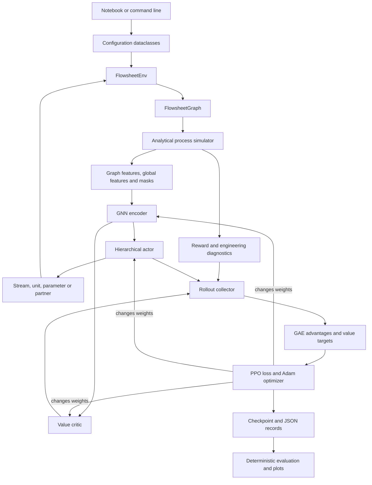
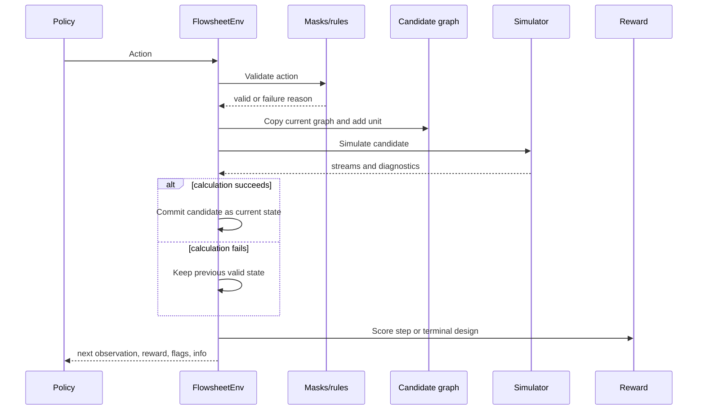

# Reading the flowsheet-RL code, one block at a time

This guide explains how the notebook and Python package work together. It is written for a reader who understands the basic ideas of flowsheets, graphs and reinforcement learning but is still learning Python and scientific machine-learning code.

The main interactive entry point is the [step-by-step teaching notebook](../notebooks/learn_flowsheet_rl_step_by_step.ipynb). It reveals the called source functions beside each stage, works through the custom equations, builds a flowsheet one action at a time, runs a small learning demonstration, and inspects the recorded long-run results. The scientific and learning logic lives in importable Python modules under [`src/flowsheet_rl`](../src/flowsheet_rl). The long terminal run calls those same modules. It does not use a second, more complicated model.

## 1. The whole program in one picture



There are four responsibilities to keep separate:

1. **Engineering state and rules:** the graph, stream values and action masks say what exists and what is allowed.
2. **Mechanistic calculation:** the analytical simulator calculates what a proposed flowsheet does.
3. **Learned decision-making:** the GNN and actor choose among allowed construction actions; the critic estimates future reward.
4. **Learning algorithm:** PPO changes neural-network weights using completed experience.

The neural network does not calculate material balances. The simulator does not choose an optimal flowsheet. PPO does not change the chemical equations.

## 2. Is this SciML?

It is a simple **hybrid scientific machine-learning workflow**:

- scientific knowledge appears in explicit balances, unit equations, graph rules and feasibility limits;
- machine learning appears in the policy and value networks;
- reinforcement learning joins them by using simulator rewards to improve decisions.

It is not a physics-informed neural network. The simulator is not embedded as a differentiable layer, and PPO does not differentiate through the reactor or separator equations. Instead, the sequence is

$$
\text{policy proposes action}\rightarrow
\text{simulator calculates result}\rightarrow
\text{reward measures result}\rightarrow
\text{PPO improves policy}.
$$

This is useful when the engineering evaluator is modular, discontinuous or non-differentiable. The price is that the agent must learn from sampled experience rather than receiving an exact gradient through the process model.

## 3. Small Python dictionary before reading the notebook

| Code idea | Plain-language meaning | Example here |
|---|---|---|
| Module | One `.py` file containing related code | [`environment.py`](../src/flowsheet_rl/environment.py) |
| Package | A directory of modules that can be imported | `flowsheet_rl` |
| Class | A blueprint for objects with stored data and behavior | `FlowsheetEnv`, `ActorCritic` |
| Object or instance | One concrete item created from a class | `env = FlowsheetEnv(...)` |
| Function | A named calculation | `reactor(stream, parameter)` |
| Method | A function attached to an object | `env.reset()`, `env.step()` |
| Dataclass | A compact class mainly used to store named values | `Action`, `Stream`, configuration classes |
| Property | A value calculated when accessed like an attribute | `stream.total`, `state.open_nodes` |
| Dictionary | Named key-value storage | `observation["globals"]` |
| NumPy array | Efficient numerical table on the CPU | component-flow vector `[A,B,C]` |
| Tensor | Multidimensional array used by PyTorch and gradients | node feature matrix $X$ |
| Inheritance | A class reuses and changes another class | target simulator inherits the source simulator |
| Context manager/decorator | Changes how a block/function executes | `@torch.no_grad()` disables gradient recording |

The main libraries have distinct jobs:

| Library | Job in this project |
|---|---|
| NumPy | Stream vectors, masks, random sampling and GAE calculations |
| NetworkX | Editable directed flowsheet graph and topological ordering |
| Gymnasium | Standard `reset`/`step` environment and declared spaces |
| PyTorch | Neural layers, automatic differentiation and Adam optimization |
| PyTorch Geometric (PyG) | Batching graph tensors and message passing |
| Matplotlib | Saved flowsheet and learning plots |
| PyYAML | Reads experiment settings from YAML files |

The most important classes are the program's cast of characters:

| Class | What one object represents | Methods/properties to read first |
|---|---|---|
| `Stream` | One material stream with A, B, C, temperature and pressure | `total`, `composition`, `record` |
| `FlowsheetGraph` | One partially constructed process | `initial`, `open_nodes`, `add_unit`, `validate` |
| `Action` | One complete hierarchical construction decision | `as_dict`, `from_dict` |
| `FlowsheetEnv` | The interaction loop around graph, simulator and reward | `reset`, `observation`, `step` |
| `SimulationResult` | Named engineering results and feasibility flags | `as_dict` |
| `GNNEncoder` | The graph-to-vector neural transformation | `forward` |
| `ActorCritic` | Policy heads plus the value estimator | `forward`, `act`, `evaluate_actions` |
| `Collector` | The running experience generator | `collect`, `state_dict` |

## 4. Notebook cells 1–2: verify and prepare the workspace

### Cell 1: verify the interpreter

```python
import torch
import torch_geometric
import flowsheet_rl
```

An `import` makes code from another package available. Printing `sys.executable` answers a crucial reproducibility question: **which Python installation is running this cell?** Printing `flowsheet_rl.__file__` verifies that the notebook is using this project’s editable source code rather than a different installation.

`torch.cuda.is_available()` reports whether PyTorch can use a CUDA GPU. This project’s validated training runner deliberately uses one CPU thread, so `False` is acceptable.

### Cell 2: find the project and import its public building blocks

The `Path` search allows the notebook to work when launched from either the project directory or a parent directory. The assertion stops immediately if the expected `src/flowsheet_rl` directory cannot be found.

```python
PROJECT = next(...)
assert PROJECT is not None
os.chdir(PROJECT)
```

The following imports are the notebook’s map to the package:

| Imported name | Defined in | Purpose |
|---|---|---|
| `ExperimentConfig` | [`config.py`](../src/flowsheet_rl/config.py) | Groups environment, reward, model and training settings |
| `FlowsheetEnv` | [`environment.py`](../src/flowsheet_rl/environment.py) | Implements the RL environment |
| `RuleBasedPolicy` | [`baselines.py`](../src/flowsheet_rl/baselines.py) | Provides a known constructive reference |
| `Action`, `Unit` | [`actions.py`](../src/flowsheet_rl/actions.py) | Represent a hierarchical construction decision |
| `to_pyg` | [`graph_state.py`](../src/flowsheet_rl/graph_state.py) | Converts a Gym graph observation to PyG tensors |
| `inspect_decision` | [`inspection.py`](../src/flowsheet_rl/inspection.py) | Exposes features, embeddings and policy outputs |
| `load_checkpoint` | [`checkpoints.py`](../src/flowsheet_rl/training/checkpoints.py) | Reconstructs a trained model from disk |
| `train` | [`ppo.py`](../src/flowsheet_rl/training/ppo.py) | Runs rollout collection and PPO updates |
| `evaluate_policy` | [`evaluation.py`](../src/flowsheet_rl/evaluation.py) | Tests policies on identical seeded feed cases |

`seed_everything(7)` seeds Python, NumPy and PyTorch and requests deterministic PyTorch algorithms. A seed is like choosing the first page in a very long book of pseudorandom numbers: the sequence still looks random, but it can be replayed.

## 5. Notebook cells 3–4: define one process case

The visible values are converted into validated dataclasses:

```python
config = ExperimentConfig(
    environment=EnvironmentConfig(...)
)
```

[`config.py`](../src/flowsheet_rl/config.py) defines four groups:

- `EnvironmentConfig`: feed conditions, specification limits and construction budget;
- `RewardConfig`: weights used to score terminal designs;
- `ModelConfig`: hidden-vector size and number of message-passing layers;
- `TrainConfig`: PPO budget and hyperparameters.

Each `__post_init__` method rejects impossible values early. For example, feed rates must be positive and purity/recovery limits must be in $(0,1]$. This is safer than letting a bad value travel deep into a simulation.

At reset, the actual feed rates are

$$
F_A=F_{A,\mathrm{nom}}U_A,
\qquad
F_B=F_{B,\mathrm{nom}}U_B,
$$

where each $U$ is sampled uniformly between $1-v$ and $1+v$, and $v$ is `feed_variation`. The same reset seed produces the same feed case.

`begin_experiment(...)` creates a new output directory and records configuration, package versions, platform and hashes of source files. This makes a result auditable.

## 6. Notebook cells 5–7: run and inspect the rule baseline

This loop is the simplest complete RL-environment workflow:

```python
obs, info = env.reset(seed=SEED)
while not env.done:
    action = RuleBasedPolicy().act(obs)
    obs, reward, terminated, truncated, info = env.step(action)
```

The words have precise meanings:

- **observation:** what the policy is allowed to see;
- **action:** the next construction decision;
- **reward:** the score returned for that decision;
- **terminated:** a natural or failure ending;
- **truncated:** the construction-step budget was reached;
- **info:** diagnostics used for analysis, not policy input.

The rule policy follows a readable sequence: mixer, thermal unit, reactor, separator, product and purge. It is not trained. Its role is to establish that the environment contains a reachable feasible design.

### What happens inside `env.step(action)`



The copy-then-simulate behavior is **transactional**. A failed proposal does not corrupt the last valid graph.

Cell 7 turns graph edges into a human-readable stream table. A stream is an immutable [`Stream`](../src/flowsheet_rl/chemistry.py) with component flows $(F_A,F_B,F_C)$, temperature and pressure. The table and residual expose what the simulator calculated rather than only showing a final score.

## 7. The process equations called by the baseline

The simulator is analytical Python, not a commercial process simulator. It walks through the directed acyclic graph in topological order, so every unit is evaluated after its upstream units.

### Mixer

[`mixer.py`](../src/flowsheet_rl/units/mixer.py) adds component flows and uses a flow-weighted temperature:

$$
\mathbf F_{out}=\mathbf F_1+\mathbf F_2,
\qquad
T_{out}=\frac{F_1T_1+F_2T_2}{F_1+F_2}.
$$

### Thermal unit

[`thermal.py`](../src/flowsheet_rl/units/thermal.py) maps the normalized action $p\in[0,1]$ to temperature:

$$
T_{out}=280+170p,
\qquad
Q=0.01F_{total}|T_{out}-T_{in}|.
$$

For example, `P = 90/170` gives $T_{out}=370$ K.

### Reactor

[`reactor.py`](../src/flowsheet_rl/units/reactor.py) uses the synthetic reaction $A+B\rightarrow C$:

$$
\tau=0.1+3.9p,
\qquad
k=0.6\exp\left(\frac{T-330}{80}\right),
$$

$$
X=\min\left(0.98,1-e^{-k\tau}\right),
\qquad
\xi=X\min(F_A,F_B),
$$

$$
\mathbf F_{out}=\mathbf F_{in}+[-1,-1,+1]\xi.
$$

The reaction extent $\xi$ prevents consumption of more A or B than is available. This is a mechanistic design choice, not a learned neural equation.

### Separator

[`separator.py`](../src/flowsheet_rl/units/separator.py) sends a large fraction of C and a smaller leakage fraction of A and B to the rich outlet:

$$
r_C=0.7+0.28p,
\qquad
\ell=0.02+0.08(1-p),
$$

$$
\mathbf F_{rich}=\mathbf F\odot[\ell,\ell,r_C],
\qquad
\mathbf F_{residual}=\mathbf F-\mathbf F_{rich}.
$$

### Flowsheet checks

[`low_fidelity.py`](../src/flowsheet_rl/simulators/low_fidelity.py) calculates

$$
\mathbf r_{component}=\mathbf F_{feed}+\boldsymbol\nu\sum\xi-\mathbf F_{frontier}.
$$

The frontier counts product, purge and still-open branches once. Feasibility requires a closed graph, balance satisfaction, purity at least 0.90 and recovery at least 0.60.

### Reward: translate design goals into one learning signal

[`reward_breakdown`](../src/flowsheet_rl/rewards.py) always charges a small step cost. At the end of an episode it adds the terminal terms

$$
\begin{aligned}
r_T={}&-0.01
+10(\text{recovery})(\text{purity})
-0.2Q
-0.3C_{capital}
-0.05N_{units}\\
&+2\,\mathbb 1_{feasible}
-4\left[\max(0,0.90-\text{purity})+\max(0,0.60-\text{recovery})\right]\\
&-2N_{open}-10\,\mathbb 1_{failure}.
\end{aligned}
$$

$\mathbb 1$ is an indicator: it equals one when the condition is true and zero otherwise. The reward tells the learner what is preferred, while masks and the simulator enforce known rules. Cell 7 prints each named term so a large or small return can be explained rather than treated as a mystery number.

## 8. Notebook cells 8–11: construct the graph manually

`manual = FlowsheetEnv(...)` creates a separate environment, so manual experiments do not alter the earlier rule episode.

The first graph has four nodes:

```text
feed A (node 0) -> open boundary (node 1)
feed B (node 2) -> open boundary (node 3)
```

An open node means “this stream still needs a destination.” `manual.state.open_nodes` returns those node IDs.

### Why masks exist

[`action_masks`](../src/flowsheet_rl/actions.py) encodes facts already known from engineering logic:

- purge is always possible for an open branch;
- product requires some C in the stream;
- reactor requires both A and B;
- separator requires some C;
- mixer requires another open stream;
- adding equipment is disabled after `max_units`.

The policy should learn preferences among meaningful choices. It should not waste samples rediscovering that one-input mixing or separating a zero-C stream is structurally meaningless.

### The `Action` record

```python
Action(selected, unit, parameter, partner)
```

contains four fields, but only some are active at each decision:

| Chosen unit | Active fields after stream selection |
|---|---|
| Mixer | `unit`, `partner` |
| Thermal/reactor/separator | `unit`, `parameter` |
| Product/purge | `unit` only |
| STOP | stream choice only |

This is a **hierarchical hybrid action** because it combines conditional discrete and continuous decisions.

[`FlowsheetGraph.add_unit`](../src/flowsheet_rl/graph_state.py) changes the selected open node into a unit. A one-output unit creates one new open node; a separator creates two. A mixer connects a second open boundary through a junction. The graph validator rejects cycles and wrong port counts.

## 9. Notebook cells 12–14: turn the flowsheet into neural features

The engineering graph is stored in NetworkX because it is easy to edit and validate. The neural network needs numerical tensors, so `graph_instance()` and `to_pyg()` translate it.

The observation can be written as

$$
s_t=(\mathcal G_t,\mathbf g_t,\mathbf m_t),
\qquad
\mathcal G_t=(V_t,E_t,X_t,Z_t),
$$

where $X$ contains node features, $Z$ contains edge features, $\mathbf g$ contains whole-flowsheet features, and $\mathbf m$ contains masks.

| Tensor | Shape | Meaning |
|---|---:|---|
| `x` or $X$ | $N\times15$ | node type plus node operating/state features |
| `edge_attr` or $Z$ | $E\times9$ | flow, composition, conditions and boundary flags |
| `edge_index` | $2\times E$ | source and receiver index for every directed edge |
| `globals` or $g$ | $1\times9$ | step, budget, costs, current product metrics and feeds |
| `stream_mask` | `max_nodes + 1` | valid open locations plus STOP |
| `unit_mask` | `max_nodes × 6` | valid unit choices at each location |

The graph tensors have the actual number of nodes and edges; they are not padded. Only masks use the configured maximum size.

### Node features

The first nine entries are a one-hot node type: exactly one position identifies feed, open, mixer, thermal, reactor, separator, product, purge or junction. The remaining six entries describe whether it is open, normalized temperature, pressure, normalized unit parameter, performance and a validity flag.

One-hot encoding avoids implying that “reactor = 4” is twice “open = 2.” Types are categories, not quantities.

### Edge features

Each material stream stores normalized total flow, three mole fractions, normalized temperature, pressure, an open-boundary flag, a currently fixed recycle flag and validity.

### Global features

These describe the complete partial design: fraction of step budget used, equipment fraction, energy and capital proxies, current routed-product purity/recovery, remaining step fraction, and the two feed amounts.

## 10. The GNN encoder

[`GNNEncoder`](../src/flowsheet_rl/models/gnn_encoder.py) changes raw graph features into learned vectors. With the default configuration, every node receives a 32-number hidden vector and two directed message-passing layers are applied.

First, a linear layer and SiLU activation project the 15 raw node features:

$$
h_v^{(0)}=\operatorname{SiLU}(W_{in}x_v+b_{in}).
$$

For an edge $u\rightarrow v$, the layer combines the sender embedding with the stream features:

$$
m_{u\rightarrow v}^{(\ell)}=operatorname{MLP}
\left([h_u^{(\ell)},z_{u\rightarrow v}]\right).
$$

Incoming messages are added:

$$
M_v^{(\ell)}=\sum_{u\rightarrow v}m_{u\rightarrow v}^{(\ell)}.
$$

The receiver is updated with a residual connection and layer normalization:

$$
h_v^{(\ell+1)}=operatorname{LayerNorm}\left(
h_v^{(\ell)}+\operatorname{SiLU}(W_sh_v^{(\ell)}+M_v^{(\ell)})
\right).
$$

“Message passing” therefore means that a downstream node learns a summary of its upstream node and connecting material stream. Two layers allow information to travel approximately two graph edges.

All node embeddings are summed and joined with global features:

$$
h_G=\tanh\left(W_G\left[\sum_{v\in V}h_v,\mathbf g\right]+b_G\right).
$$

$h_G$ is the learned fingerprint of the partial flowsheet. Sum pooling is independent of the arbitrary order in which nodes are listed.

`inspect_decision(...)` reproduces the first message calculation explicitly and reports `message_example`. It is a teaching instrument; it does not modify the model.

## 11. The hierarchical actor and critic

[`ActorCritic`](../src/flowsheet_rl/models/actor_critic.py) shares the GNN encoder and then branches into several small multilayer perceptrons.

The joint policy factorizes according to the active branch:

$$
\pi(a_t|s_t)=
\pi_S(s|s_t)\,
\pi_U(u|s,s_t)\,
\begin{cases}
\pi_P(p|u,s,s_t), & u\in\{\text{thermal, reactor, separator}\},\\
\pi_M(m|u,s,s_t), & u=\text{mixer},\\
1, & u\in\{\text{product, purge}\}.
\end{cases}
$$

### Stream head

Every node is scored using its local embedding together with the graph embedding. A separate head scores STOP. Invalid locations receive logit $-\infty$, which gives zero categorical probability.

### Unit head

After a stream is selected, another head scores the six unit types using the selected node and graph embeddings. The conditional unit mask again sets impossible probabilities to zero.

### Continuous parameter heads

Thermal, reactor and separator each have their own head that emits two raw numbers. [`beta_distribution`](../src/flowsheet_rl/models/distributions.py) converts them to positive concentrations:

$$
\alpha=\operatorname{softplus}(r_1)+1,
\qquad
\beta=\operatorname{softplus}(r_2)+1,
\qquad
p\sim\operatorname{Beta}(\alpha,\beta).
$$

The sample lies between zero and one. Each unit equation then maps it to its own engineering meaning.

### Mixer partner head

For a mixer, a categorical head scores every other open node using the selected node, candidate partner and graph embeddings.

### Critic

The critic reads $h_G$ and estimates one scalar:

$$
V_\phi(s_t)\approx
\mathbb E\left[\sum_{k=0}^{T-t}\gamma^k r_{t+k}\mid s_t\right].
$$

It predicts expected future discounted reward from the current partial design. It does not choose an action.

During training, actions are sampled to explore. During deterministic evaluation, categorical argmax and Beta means are used.

## 12. Log-probability and why all active action pieces matter

PPO needs the probability of the complete action. Because the policy is conditional, log-probabilities add:

$$
\log\pi(a_t|s_t)=
\log\pi_S+
\log\pi_U+
\log\pi_{P\text{ or }M}.
$$

Inactive fields contribute nothing. For example, a purge action has no continuous-parameter probability. [`PolicyOutput`](../src/flowsheet_rl/models/actor_critic.py) stores component and joint log-probabilities, entropy and critic value so that the notebook can inspect them and PPO can later reuse them.

The exact hierarchical entropy also accounts for the probability of reaching each conditional branch. Entropy measures distributional uncertainty, not engineering disorder. A continuous Beta distribution can have negative differential entropy; this is mathematically allowed.

## 13. Notebook cells 15–18: execute and compare policies

Cell 14 repeatedly calls `model.act(obs)`. The historical checkpoint runs inference only: its weights do not change.

Cell 16 evaluates random, rule and checkpoint policies on feed seeds 101–105. [`evaluate_policy`](../src/flowsheet_rl/evaluation.py) creates a fresh environment for each case, records every action and graph, and calculates means and sample standard deviations.

Two kinds of variation must not be confused:

- different **evaluation feed seeds** test one fixed policy under different feeds;
- different **training seeds** create independently trained policies.

Five feeds for one checkpoint are not five independent learning experiments.

Cell 18 displays historical smoke-run figures. They explain the original bounded test, not the later 102,400-transition run.

## 14. Notebook cells 19–20: the short training demonstration

When `RUN_TRAINING = True`, the notebook creates

```python
TrainConfig(updates=2, rollout_steps=32, epochs=2)
```

and calls the same [`train`](../src/flowsheet_rl/training/ppo.py) function used by the long terminal run. The short notebook demonstration collects

$$
2\text{ updates}\times32\text{ transitions/update}=64\text{ transitions}.
$$

It is small so a learner can inspect its outputs quickly. It is not a different or simplified learning algorithm.

## 15. What the rollout collector stores

[`Collector.collect`](../src/flowsheet_rl/training/rollout.py) interacts with the environment for a fixed number of transitions. For each transition it stores:

- the observation $s_t$;
- sampled action $a_t$;
- old joint log-probability $\log\pi_{old}(a_t|s_t)$;
- reward $r_t$;
- critic prediction $V(s_t)$;
- next-state value when bootstrapping is allowed;
- episode-boundary flags.

Completed episodes also record return, feasibility, purity, recovery, energy, capital and termination reason.

“Rollout steps” means environment transitions, not complete episodes. A 256-transition rollout may contain many short flowsheets and may end partway through another flowsheet.

## 16. GAE: deciding which outcomes were better than expected

[`generalized_advantages`](../src/flowsheet_rl/training/advantages.py) first calculates the temporal-difference surprise

$$
\delta_t=r_t+\gamma b_tV(s_{t+1})-V(s_t),
$$

where $b_t$ is one if bootstrapping is allowed and zero after a true terminal design. It then accumulates surprises backward:

$$
A_t=\delta_t+\gamma\lambda(1-d_t)A_{t+1}.
$$

$d_t$ prevents information from leaking across independent episodes. The value target is

$$
R_t=A_t+V(s_t).
$$

An advantage above zero means the sampled outcome was better than the critic expected. An advantage below zero means it was worse.

## 17. PPO: changing the network carefully

The probability ratio compares the current policy with the policy that collected the action:

$$
\rho_t(\theta)=
\exp\left(\log\pi_\theta(a_t|s_t)-\log\pi_{old}(a_t|s_t)\right).
$$

The clipped actor objective is

$$
L_{actor}=-\mathbb E_t\left[
\min\left(
ho_tA_t,
\operatorname{clip}(\rho_t,1-\epsilon,1+\epsilon)A_t\right)
\right].
$$

Clipping limits how much one update can benefit from making the new policy very different from the data-collecting policy.

The implemented total loss is

$$
L=L_{actor}+c_V\mathbb E[(V(s_t)-R_t)^2]-c_H\mathbb E[H(\pi(\cdot|s_t))].
$$

The first term trains choices, the second trains value prediction, and the third encourages exploration. PyTorch automatic differentiation computes gradients of this loss with respect to neural weights. Adam applies the parameter update, and gradient-norm clipping limits extreme steps.

One important boundary remains: gradients flow through the actor, critic and GNN, but not backward through the simulator.

## 18. How the long Python routine relates to the notebook

The completed command was conceptually:

```powershell
.\.venv\Scripts\python.exe scripts/train.py --config configs/train_long.yaml --out runs/my_long_run
```

The call chain is:

```text
scripts/train.py
  -> flowsheet_rl.cli.main("train", ...)
     -> load_config(configs/train_long.yaml)
     -> begin_experiment(...)
     -> training.ppo.train(...)
        -> Collector.collect(...)
        -> generalized_advantages(...)
        -> ActorCritic.evaluate_actions(...)
        -> loss.backward()
        -> Adam.step()
        -> checkpoint/log persistence
     -> evaluate_policy(...)
```

[`train_long.yaml`](../configs/train_long.yaml) requested:

| Setting | Value | Meaning |
|---|---:|---|
| updates | 400 | repeat collect-and-learn 400 times |
| rollout steps | 256 | collect 256 transitions before each update |
| epochs | 2 | revisit each rollout twice |
| minibatch size | 32 | process 32 stored transitions per optimizer step |
| checkpoint interval | 5 | save durable state every five updates |
| evaluation interval | 10 | test deterministic policy every ten updates |

Therefore the run collected

$$
400\times256=102{,}400\text{ transitions}.
$$

Each update used $2\times(256/32)=16$ optimizer steps, giving 6,400 optimizer steps over the run. Reusing a rollout for two epochs does not add environment transitions.

The completed record reports 18,108 episodes, first feasible training behavior at transition 528, and 2,991 seconds elapsed. Its final deterministic evaluation was feasible in four of five stored feed cases. This is evidence for this run, not proof that every independent training seed will learn equally well.

## 19. What was saved and what each file answers

The completed directory is [`my_long_run`](../examples/long_run):

| File | Question answered |
|---|---|
| [`metadata.json`](../examples/long_run/metadata.json) | Which configuration, code hashes and packages produced the run? |
| `training.json` (created by a fresh run; omitted from this compact evidence bundle) | What happened in every update, episode and periodic evaluation? |
| [`progress.json`](../examples/long_run/progress.json) | What was the latest completed update? |
| `checkpoint.pt` | Generated by a fresh run; omitted from the mini public repository |
| [`evaluation/summary.json`](../examples/long_run/evaluation/summary.json) | How did the final deterministic policy perform overall? |
| [`evaluation/episodes.csv`](../examples/long_run/evaluation/episodes.csv) | How did each feed seed perform? |
| [`evaluation/designs.json`](../examples/long_run/evaluation/designs.json) | Which actions and complete graphs were produced? |
| [`evaluation/best_design.png`](../examples/long_run/evaluation/best_design.png) | What did the highest-return evaluated flowsheet look like? |
| [`plots/training_overview.png`](../examples/long_run/plots/training_overview.png) | How did return, feasibility and PPO diagnostics change? |
| [`plots/evaluation_by_seed.png`](../examples/long_run/plots/evaluation_by_seed.png) | Which final feed cases passed the specification? |

[`save_checkpoint`](../src/flowsheet_rl/training/checkpoints.py) uses a temporary file and atomic replacement. A new-format checkpoint stores model weights, optimizer state, the partial flowsheet, random-generator states and training history. That is why exact continuation can resume at a saved update boundary.

## 20. A practical order for reading the actual source

Read the files in the order an action travels through the program:

1. [`config.py`](../src/flowsheet_rl/config.py): learn the named settings.
2. [`chemistry.py`](../src/flowsheet_rl/chemistry.py): inspect the `Stream` object.
3. [`graph_state.py`](../src/flowsheet_rl/graph_state.py): see how units and streams form a graph.
4. [`actions.py`](../src/flowsheet_rl/actions.py): see action records, masks and validation.
5. [`environment.py`](../src/flowsheet_rl/environment.py): follow `reset`, `observation` and `step`.
6. [`units`](../src/flowsheet_rl/units): verify the process equations.
7. [`low_fidelity.py`](../src/flowsheet_rl/simulators/low_fidelity.py): follow topological simulation and feasibility.
8. [`gnn_encoder.py`](../src/flowsheet_rl/models/gnn_encoder.py): follow features through message passing.
9. [`actor_critic.py`](../src/flowsheet_rl/models/actor_critic.py): follow conditional action distributions and value.
10. [`rollout.py`](../src/flowsheet_rl/training/rollout.py): see how experience is collected.
11. [`advantages.py`](../src/flowsheet_rl/training/advantages.py): verify the short GAE calculation.
12. [`ppo.py`](../src/flowsheet_rl/training/ppo.py): follow minibatches, loss, gradients and persistence.
13. [`evaluation.py`](../src/flowsheet_rl/evaluation.py): see how fixed-case comparisons are produced.
14. [`cli.py`](../src/flowsheet_rl/cli.py): see how terminal arguments connect everything.

## 21. Suggested notebook experiments for understanding, not performance

Change one thing at a time and explain the consequence before running it:

1. Set feed variation to zero and verify that repeated resets with different seeds have identical feeds.
2. Manually mix the feeds, then inspect how the node and edge counts change.
3. Heat to two different temperatures and predict which reactor conversion will be larger.
4. Change the separator parameter and predict purity, recovery and energy trends.
5. At an initial state, explain why reactor and separator are masked but mixer is allowed.
6. Print the shapes before and after adding a unit; identify which dimensions remain fixed.
7. Compare stochastic `model(obs)` with deterministic `model.act(obs)` without training.
8. Run the 64-transition demonstration and locate its two updates in `training.json`.

These exercises test whether you can connect code, tensors and engineering meaning. They are not intended to improve the policy.

## 22. Common misunderstandings

| Misunderstanding | Correct interpretation |
|---|---|
| An epoch is a flowsheet episode. | A PPO epoch is one reuse of a collected rollout for optimization. |
| A rollout of 256 means 256 flowsheets. | It means 256 environment transitions across however many episodes finish. |
| The GNN simulates chemistry. | It encodes the partial graph; explicit unit equations simulate chemistry. |
| A high reward guarantees feasibility. | Always inspect closure, balances, purity and recovery separately. |
| The critic finds the best action. | It estimates expected future reward; actor heads select actions. |
| Evaluation feeds are independent training runs. | They are different cases for one fixed trained policy. |
| The target fidelity is rigorous. | It is another deliberately perturbed analytical toy model. |
| `first_feasible_step=528` proves convergence. | It records the first feasible sampled training episode, not stable final performance. |

## 23. Where the prototype stops

The current code has no recycle convergence, phase equilibrium, rigorous thermodynamics, industrial economics, pressure-changing equipment, uncertainty model or globally optimality guarantee. The graph is acyclic, the chemistry is synthetic, and the simulator is deterministic. These limits make the code small enough to audit and learn from.

The architecture is closest to the graph-based hierarchical actor–critic approach of Stops, Gao and Schweidtmann. It is a simplified implementation with PyTorch Geometric, a synthetic process case and a joint-action PPO likelihood. See the [paper-to-prototype mapping](paper_mapping.md) for exact similarities and deviations.

## 24. One-sentence mental model

At every step, the code converts a partially built process graph into tensors, uses a GNN to summarize local streams and the whole flowsheet, samples a valid hierarchical construction action, evaluates that action with explicit process equations, and later uses PPO to make better-than-expected actions more likely without changing the engineering model.
