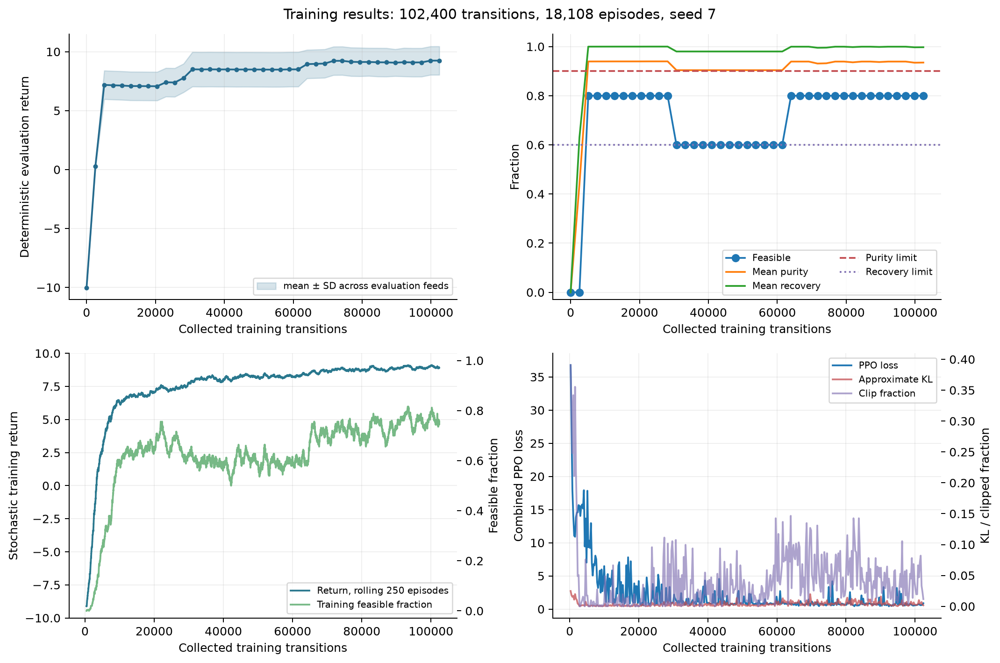

# Recorded long-campaign result

The public example bundle records one CPU campaign executed with `configs/train_long.yaml`:

| Quantity | Recorded value |
|---|---:|
| PPO updates | 400 |
| Transitions | 102,400 |
| Completed training episodes | 18,108 |
| First sampled feasible design | transition 528, episode 285 |
| Elapsed training time | 2,991.21 s |
| Parameter change, L2 norm | 8.3340 |
| Deterministic feasible cases | 4 of 5 |
| Deterministic mean return | 9.245 |
| Mean product purity | 0.935 |
| Mean product recovery | 0.997 |

These measurements establish that the code executed and learned useful behavior for most of five nearby synthetic feed cases. One training seed and five evaluation cases are insufficient for a claim of robust generalization, algorithmic superiority, or industrial validity. The rule-based policy remains an engineering reference that demonstrates reachable feasibility; it is not an optimal target or imitation dataset.

The versioned evidence under [`examples/long_run`](../examples/long_run) contains the metadata, final progress record, deterministic evaluation summary, per-seed table, generated graph records, and plots. Checkpoints and the full raw training history were omitted to keep this mini repository compact. Run a fresh campaign to generate the complete record.
