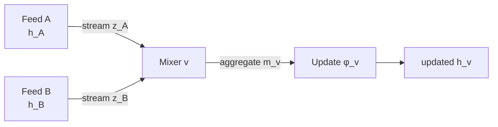
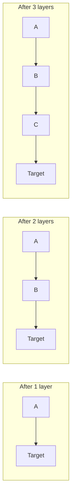
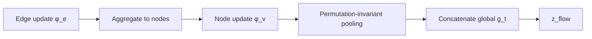
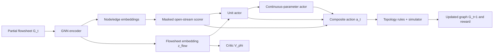
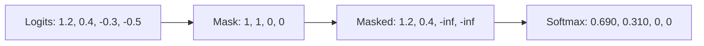
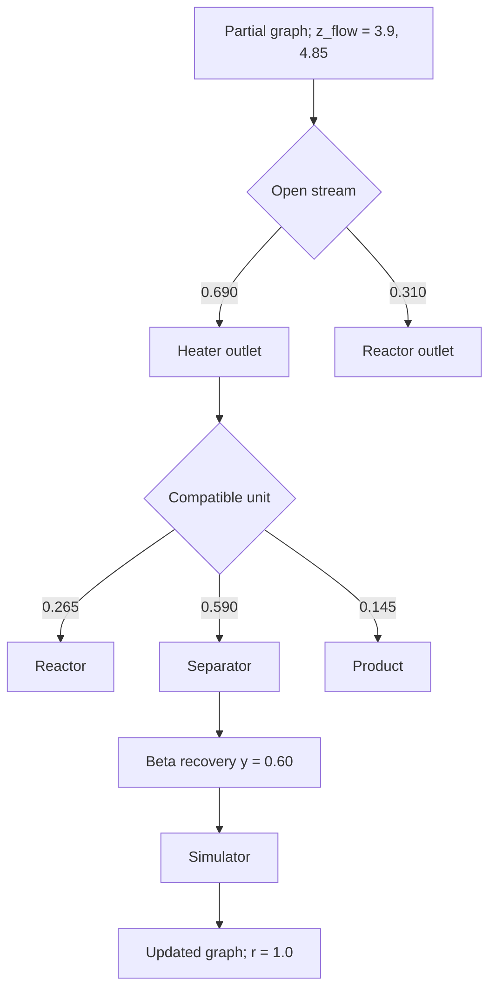
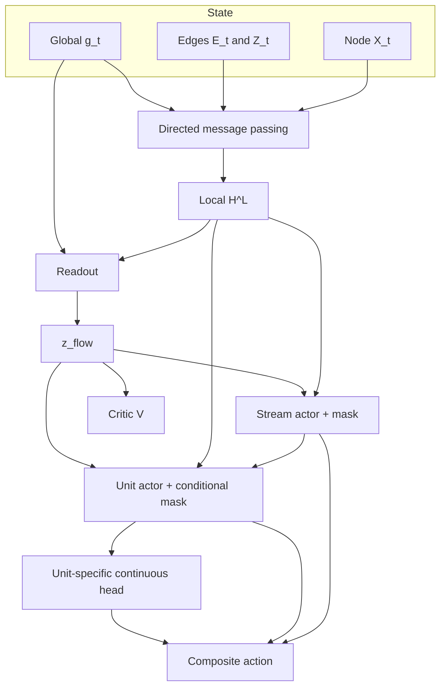

# GNNs and Hierarchical Actor–Critic Methods for Flowsheet Synthesis

## Scope and evidence map

This tutorial develops **Module 3: graph neural networks and message passing** and **Module 4: hierarchical actor–critic architectures with discrete and continuous actions** for sequential chemical-process flowsheet synthesis. It uses the notation

$$
\mathcal{G}_t=(\mathcal{V}_t,\mathcal{E}_t,X_t,Z_t,g_t),
$$

where nodes primarily represent unit operations and directed edges primarily represent material streams. The principal running example is a pedagogical process for $A+B\rightarrow C$; every numerical value and neural-network output in that example is invented for teaching and is **not** a literature result.

Four kinds of statements are kept separate:

- **Established theory:** mathematical properties of message passing, policy gradients, value functions, PPO, and related methods.
- **Published architecture:** details explicitly reported by Stops, Leenhouts, Gao, and Schweidtmann.
- **Modeling choices:** defensible alternatives that are not mandated by theory or by the primary paper.
- **Teaching examples:** deliberately small calculations designed to make the algorithms tangible.

The orientation video is titled *Reinforcement learning for the design of chemical processes using graph neural networks*, presented by Qinghe Gao and published by Process Intelligence Research on 18 January 2025. Its description links the primary article, the 2024 review, and the transfer-learning conference paper; the transcript is consistent with the high-level graph-encoder, actor–critic, hybrid-action, simulator, reward, and transfer-learning narrative, but this tutorial relies on the papers for architecture claims.

The verified primary article is Laura Stops, Roel Leenhouts, Qinghe Gao, and Artur M. Schweidtmann, “Flowsheet generation through hierarchical reinforcement learning and graph neural networks,” *AIChE Journal* 69(1), e17938, 2023, DOI [10.1002/aic.17938](https://doi.org/10.1002/aic.17938). It appeared online in 2022 and in the 2023 journal issue, which explains conflicting year labels in databases. The verified review is Qinghe Gao and Artur M. Schweidtmann, “Deep reinforcement learning for process design: Review and perspective,” *Current Opinion in Chemical Engineering* 44, 101012, 2024, DOI [10.1016/j.coche.2024.101012](https://doi.org/10.1016/j.coche.2024.101012).

### Published architecture at a glance

The primary article represents flowsheets as graphs, derives a flowsheet fingerprint through several graph-convolution/message-passing layers and sum pooling, and uses a three-level actor: select an open stream, select a unit operation, and select one continuous unit-specific design variable. The discrete location decision operates on updated node representations, whereas the unit and continuous heads use the pooled fingerprint plus the selected node identifier; the continuous heads return $\alpha,\beta$ for a Beta distribution. A separate MLP critic predicts state value, and training is adapted from PPO while using generalized advantage estimation.

This is **hierarchical action decomposition within one environment step**, not necessarily hierarchical RL in the classical options sense. Classical options are temporally extended actions with an initiation set, an internal policy, and a termination condition, producing a semi-Markov description; the primary flowsheet architecture instead chooses dependent sub-actions that jointly define one graph-edit action.

## Learning objectives and prerequisite check

After 10–15 hours of study and exercises, the learner should be able to:

- Explain why an attributed graph still requires a learned encoder.
- Write and dimension-check node, edge, and global message-passing equations.
- Manually calculate messages, aggregation, node updates, and graph pooling.
- Distinguish permutation equivariance from graph-level permutation invariance.
- Diagnose limited receptive fields, oversmoothing, over-squashing, and expressivity failures.
- Explain actor, critic, policy gradient, TD error, GAE, and PPO clipping.
- Build and correctly score a conditionally factorized hybrid action.
- Apply masks before normalization and distinguish invalid from merely unattractive actions.
- Trace tensors through a small PyTorch Geometric implementation.

Prerequisite self-check:

1. Can $V^\pi(s)$, $Q^\pi(s,a)$, and $A^\pi(s,a)$ be distinguished without looking them up?
2. Is it clear why renumbering units must not change a flowsheet-level decision?
3. Can an episode be described as a sequence of partial flowsheets and graph-edit actions?
4. Is the difference between topology validation and simulator feasibility clear?

If any answer is “no,” revisit the relevant part of Modules 1–2 before beginning Module 4.

## Module 3: intuitive understanding

### Why the graph needs an encoder

A flowsheet graph is like a circuit diagram: it organizes facts, but it does not decide what those facts imply. The raw graph records that a mixer feeds a heater and the heater feeds a reactor; an encoder must learn useful numerical summaries such as “this open stream sits downstream of premixing but upstream of reaction” or “this recycle may affect the reactor after several graph hops.” Message-passing GNNs learn functions of node attributes, edge attributes, and connectivity rather than treating connectivity as incidental metadata.

A conventional MLP expects a fixed-length vector. Padding every flowsheet to a maximum number of units makes the model sensitive to arbitrary flattening conventions and wastes capacity; a CNN on an adjacency-like matrix also treats neighboring matrix cells as if they were meaningful spatial neighbors. The process-design review emphasizes that fixed matrix encodings have many permutations and that standard MLP/CNN processing is not inherently permutation equivariant, while message-passing graph models operate directly on physical connectivity and variable graph sizes.

A drawing of a flowsheet is not the same as its process graph: moving a reactor icon changes pixels without changing the process. A sequence is similarly incomplete unless augmented with explicit references, because a linear order does not naturally preserve a split, merge, or recycle. A GNN is therefore expected to learn task-useful relational features—local equipment context, upstream/downstream patterns, and graph-level signatures—but the simulator must still enforce balances, thermodynamics, kinetics, equipment models, and convergence.

**Common misunderstanding:** the GNN “simulates” material flow. It does not, unless explicitly trained as a surrogate with appropriate outputs and constraints. In the architecture studied here, it encodes simulator-produced state information to help choose actions.

**Implementation failure mode:** feeding future final-product purity or final profitability into a partial-state graph. This leaks unavailable information and can make an apparently strong policy unusable at deployment.

### A process analogy

Each unit sends a short technical note to a neighboring unit. The note may combine “what kind of unit sent me this?”, “what are the stream conditions?”, and “what does the receiving unit currently know?” The receiver combines all incoming notes and updates its internal summary. Repeating this operation lets information move farther through the flowsheet.



The diagram is computational, not a material-balance equation. Messages can correlate stream conditions and topology, but their hidden coordinates do not automatically correspond to flow, enthalpy, or exergy.

## Module 3: mathematical development

### Features and dimensions

For a graph with $n_t=|\mathcal V_t|$ nodes and $e_t=|\mathcal E_t|$ edges, use:

| Tensor | Shape | Typical process meaning |
|---|---:|---|
| $X_t$ | $n_t\times d_x$ | Unit type, design variables, node status, masks |
| $Z_t$ | $e_t\times d_z$ | Flow, composition, temperature, pressure, phase, validity |
| $g_t$ | $d_g$ | Feed specification, step count, objective context, current feasible aggregates |
| $H^{(\ell)}$ | $n_t\times d_h$ | Learned node states at layer $\ell$ |
| $H_E^{(\ell)}$ | $e_t\times d_e$ | Learned edge states when edges are updated |
| $z_t^{\mathrm{flow}}$ | $d_f$ | Pooled graph-level representation |

Categorical types are one-hot vectors or learned embeddings. Continuous values should be consistently scaled; undefined values need explicit availability masks rather than a numerical sentinel that could be mistaken for a real process value.

### Initial embeddings

**Problem solved.** Raw node and edge features may have different dimensions and scales, whereas message functions usually need fixed-width hidden vectors.

$$
h_v^{(0)}=f_V(x_v), \qquad h_{uv}^{(0)}=f_E(z_{uv}), \qquad g^{(0)}=f_G(g_t).
$$

Here $x_v\in\mathbb R^{d_x}$, $z_{uv}\in\mathbb R^{d_z}$, $h_v^{(0)}\in\mathbb R^{d_h}$, and $h_{uv}^{(0)}\in\mathbb R^{d_e}$. The functions $f_V,f_E,f_G$ can be linear maps or MLPs. “Learnable MLP” means its weights are adjusted by gradient descent to improve the final RL objective; it does not mean the MLP knows chemistry independently.

### Message, aggregate, update

**Problem solved.** A unit must combine a variable number of neighboring streams into a fixed-width state.

For layer $\ell$, a general directed edge message is

$$
m_{u\rightarrow v}^{(\ell)}=
\phi_m^{(\ell)}\!\left(
 h_u^{(\ell)},h_v^{(\ell)},h_{uv}^{(\ell)},g^{(\ell)}
\right),
\tag{1}
$$

where $u\rightarrow v\in\mathcal E_t$, $h_u$ is the sender state, $h_v$ is the receiver state, $h_{uv}$ is the stream embedding, and $g$ contains graph-level context. If $\phi_m:\mathbb R^{2d_h+d_e+d_g}\rightarrow\mathbb R^{d_m}$, then every edge produces $m_{u\rightarrow v}^{(\ell)}\in\mathbb R^{d_m}$.

The incoming messages are aggregated:

$$
\bar m_v^{(\ell)}=
\operatorname{AGG}\left\{
 m_{u\rightarrow v}^{(\ell)}:u\in\mathcal N^-(v)
\right\}\in\mathbb R^{d_m},
\tag{2}
$$

where $\mathcal N^-(v)$ is the set of immediate predecessors of $v$. Finally,

$$
h_v^{(\ell+1)}=
\phi_v^{(\ell)}\!\left(h_v^{(\ell)},\bar m_v^{(\ell)},g^{(\ell)}\right).
\tag{3}
$$

These equations formalize “collect information from incoming material streams, then update the receiving unit.” PyTorch Geometric’s `MessagePassing` abstraction uses this same message–aggregate–update pattern.

**Assumption:** one layer uses one-hop graph neighbors, not physical time or axial position. **Common misunderstanding:** $m_{u\rightarrow v}$ is not a mass-flow vector unless constrained and designed as one. **Failure mode:** excluding edge features causes two streams with identical endpoint unit types but very different compositions to look identical.

### Edge and global updates

A richer graph network updates streams before units:

$$
h_{uv}^{(\ell+1)}=
\phi_e^{(\ell)}\!\left(h_{uv}^{(\ell)},h_u^{(\ell)},h_v^{(\ell)},g^{(\ell)}\right),
\tag{4}
$$

then aggregates updated incoming edge states to update nodes. A global update can use pooled edge and node summaries:

$$
g^{(\ell+1)}=
\phi_g^{(\ell)}\!\left(
 g^{(\ell)},
 \rho_{E\rightarrow G}\{h_{uv}^{(\ell+1)}\},
 \rho_{V\rightarrow G}\{h_v^{(\ell+1)}\}
\right).
\tag{5}
$$

This node–edge–global formulation is useful when stream attributes deserve latent states of their own or when global task conditions should interact repeatedly with local units. A simple GCN commonly updates nodes while holding edge structure fixed; therefore “GCN,” “generic MPNN,” and “full graph network” should not be treated as synonyms.

### Direction, self-information, and residuals

For a reactor, incoming messages answer “what is entering me?” Outgoing-message aggregation answers “what have I already sent downstream?” Both can matter for synthesis, especially around recycles. A practical directed layer can compute separate summaries,

$$
\bar m_v^{\mathrm{in}}=\operatorname{AGG}_{u\in\mathcal N^-(v)}m_{u\rightarrow v},
\qquad
\bar m_v^{\mathrm{out}}=\operatorname{AGG}_{w\in\mathcal N^+(v)}m_{v\rightarrow w},
$$

and concatenate them in the update. Treating every directed edge as undirected lets downstream information reach upstream nodes immediately, which may aid decision-making but changes the inductive bias and should be documented.

A self-loop explicitly includes $v\rightarrow v$; alternatively, Equation (3) already retains $h_v^{(\ell)}$. A residual update,

$$
h_v^{(\ell+1)}=h_v^{(\ell)}+F^{(\ell)}(h_v^{(\ell)},\bar m_v^{(\ell)}),
$$

helps preserve earlier information and improves gradient flow. Dimension matching or a projection is required.

### Receptive fields

After one standard message-passing layer, a node can depend on one-hop neighbors; after $L$ layers, at most its $L$-hop neighborhood. Thus a five-edge recycle influence cannot reach the upstream target with two purely local layers.



The diagram shows computational reach, not three different flowsheets. Recycle edges can shorten graph distance, but long loops and densely branched upstream regions can still create information bottlenecks.

### Aggregation choices

The aggregation must be insensitive to the order in which neighboring units happen to be stored. Otherwise, renumbering streams changes the answer even though the process has not changed.

| Aggregator | Preserves | Loses or risks | Graph-size effect | Flowsheet interpretation |
|---|---|---|---|---|
| Sum | Multiplicity and accumulated magnitude | Can confound larger neighborhoods with larger features | Scales with degree/size | Useful when total contribution matters |
| Mean | Average pattern, degree-normalized scale | Exact multiplicity and totals | Relatively size stable | Useful for typical-neighbor conditions |
| Max | Strongest coordinate-wise signal | Counts and all non-maximal evidence | Weak direct size dependence | Detects extreme warnings or dominant motifs |
| Attention-weighted sum | Learned relative importance | Can ignore weak-but-important streams; weights are not causal explanations | Usually normalized within neighborhood | Lets the task prioritize selected streams |

Suppose two incoming scalar messages are 2 and 5. Sum gives 7, mean gives 3.5, and max gives 5. Duplicating both neighbors changes sum to 14 but leaves mean and max unchanged. No aggregator is universally best; choice should match whether totals, averages, extremes, or context-dependent relevance are important. PyG exposes sum, mean, and max aggregation and graph-pooling operators.

### Equivariance and invariance

Let $P$ permute node rows and consistently relabel the edges. A node encoder $F$ is permutation **equivariant** if

$$
F(PX,P\mathcal E)=P F(X,\mathcal E).
\tag{6}
$$

The node embeddings move with their nodes. A graph readout $R$ is permutation **invariant** if

$$
R(PH,P\mathcal E)=R(H,\mathcal E).
\tag{7}
$$

The graph vector stays unchanged. Equivariance is required for local selection: the score attached to open stream node 4 must follow that node if it is renamed node 1. Invariance is required for the critic: the value of the same physical flowsheet must not depend on array order.

### Graph readout

**Problem solved.** Actor and critic heads often need one fixed-width vector even though $|\mathcal V_t|$ varies.

$$
z_t^{\mathrm{flow}}=
\operatorname{READOUT}\left(
\{h_v^{(L)}:v\in\mathcal V_t\},g_t
\right).
\tag{8}
$$

Options include:

- **Sum pooling:** preserves accumulated magnitude and some graph-size information.
- **Mean pooling:** represents an average node but can make a duplicated subgraph look unchanged.
- **Max pooling:** detects dominant coordinates but discards counts.
- **Attention pooling:** learns weights conditioned on node and perhaps global features.
- **Virtual/global node:** exchanges messages with all units and becomes a learned collector.
- **Global concatenation:** pool nodes first, then set $z=[r;g_t]$, preserving known process-level context directly.

PyG defines `global_mean_pool` as the per-graph average over node features, yielding one graph vector per graph in a batch. A compact embedding is only an optimized latent statistic. Without dedicated supervision or causal analysis, its coordinates cannot be called “conversion,” “profitability,” or “recycle quality.”



### Relevant architecture families

| Family | Core operation | Strength for flowsheets | Important limitation |
|---|---|---|---|
| GCN | Degree-normalized neighbor mixing | Simple, efficient baseline | Edge attributes and direction need explicit adaptation; fixed weighting |
| GAT | Learned attention over neighbors | Can weight streams differently | Attention is not proof of causal importance; still local |
| Generic MPNN | Learned messages using sender, receiver, and edge | Natural for attributed streams | Design choices are broad; can overfit simulator artifacts |
| Heterogeneous GNN | Type/relation-specific maps | Distinguishes unit and connection types | More parameters and sparse type combinations |
| Graph network | Explicit edge, node, global updates | Matches stream–unit–flowsheet hierarchy | Greater complexity and more opportunities for leakage |

GCN was introduced as localized graph convolution with node representations encoding graph structure and features. GAT introduces masked self-attention on graph neighborhoods. Gilmer et al. unified many graph models as message-passing networks that learn message and aggregation functions for graph-level predictions. The primary flowsheet paper uses GCN/MPNN language and sum pooling; the richer edge/global updates above are recommended modeling alternatives, not claims about that implementation.

### Physical inductive biases

Physics can enter at several levels:

- Use directed, typed edges and port-aware connectivity.
- Encode dimensionless or scaled process quantities and availability masks.
- Use conservation residuals as features, auxiliary losses, or constrained layer outputs.
- Build equivariant split/mix operators that aggregate flow-weighted compositions.
- Separate material, heat, utility, and control edge types.
- Couple the learned policy to hard topology masks and simulator feasibility checks.
- Pretrain a graph encoder on physically relevant tasks, then fine-tune for RL.

These choices do not guarantee thermodynamic consistency. Hard consistency requires architecture or solver-level enforcement; a penalty can still be violated.

### Biomass/hydrogen sidebar

For lignocellulosic valorization, a heterogeneous graph could distinguish a pretreatment reactor, hydrolysis reactor, fermentation unit, solid–liquid separator, and wastewater treatment, with material, heat, and enzyme-addition edge types. For renewable hydrogen, nodes might include PV, electrolyzer, compressor, storage, and grid interface; electricity and material connections should be separate edge relations because “power sent to electrolyzer” is not a material stream. This is a modeling proposal, not an architecture verified in the primary paper.

## Module 3: complete numerical example

### Pedagogical graph

Use five nodes:

- $v_0=F_A$: feed A
- $v_1=F_B$: feed B
- $v_2=M$: mixer
- $v_3=H$: heater
- $v_4=R$: reactor

Edges are $F_A\rightarrow M$, $F_B\rightarrow M$, $M\rightarrow H$, and $H\rightarrow R$. Hidden vectors have dimension $d_h=2$, and edge vectors have $d_e=2$. For this teaching calculation, coordinates have no learned physical names; they merely combine a “feed/reactive-context” coordinate and a “conditioning/unit-context” coordinate.

Initial node embeddings:

$$
\begin{aligned}
h_{F_A}^{(0)}&=[1,0], &h_{F_B}^{(0)}&=[0,1],\\
h_M^{(0)}&=[0.5,0.5], &h_H^{(0)}&=[0,1],\\
h_R^{(0)}&=[1,0.5].
\end{aligned}
$$

Edge features, all in $\mathbb R^2$, are

$$
h_{F_AM}^{(0)}=[0.8,0.2],\quad
h_{F_BM}^{(0)}=[0.2,0.8],\quad
h_{MH}^{(0)}=[0.6,0.4],\quad
h_{HR}^{(0)}=[0.7,0.3].
$$

Use deliberately simple functions:

$$
m_{u\rightarrow v}=h_u^{(0)}+0.5h_{uv}^{(0)},
\quad
\bar m_v=\sum_{u\in\mathcal N^-(v)}m_{u\rightarrow v},
\quad
h_v^{(1)}=0.5h_v^{(0)}+\bar m_v.
\tag{9}
$$

There are no biases, nonlinearities, global inputs, or reverse messages.

### Every edge message

$$
m_{F_A\rightarrow M}=[1,0]+0.5[0.8,0.2]=[1.4,0.1].
$$

$$
m_{F_B\rightarrow M}=[0,1]+0.5[0.2,0.8]=[0.1,1.4].
$$

$$
m_{M\rightarrow H}=[0.5,0.5]+0.5[0.6,0.4]=[0.8,0.7].
$$

$$
m_{H\rightarrow R}=[0,1]+0.5[0.7,0.3]=[0.35,1.15].
$$

Manual check: each result has shape $(2,)$, and each coordinate is sender coordinate plus half the corresponding edge coordinate.

### Mixer aggregation and update

The mixer has two incoming neighbors:

$$
\bar m_M=[1.4,0.1]+[0.1,1.4]=[1.5,1.5].
$$

Its update is

$$
h_M^{(1)}=0.5[0.5,0.5]+[1.5,1.5]=[1.75,1.75].
$$

The equal coordinates arise because the two feeds and their edge attributes were constructed symmetrically. This is not a material balance; it is a latent update.

Updating every node with empty incoming aggregation equal to $[0,0]$ gives

$$
\begin{aligned}
h_{F_A}^{(1)}&=[0.5,0],\\
h_{F_B}^{(1)}&=[0,0.5],\\
h_M^{(1)}&=[1.75,1.75],\\
h_H^{(1)}&=0.5[0,1]+[0.8,0.7]=[0.8,1.2],\\
h_R^{(1)}&=0.5[1,0.5]+[0.35,1.15]=[0.85,1.4].
\end{aligned}
$$

### Sum pooling

Use the published paper’s general choice of sum pooling, but not its trained weights:

$$
z_t^{\mathrm{flow}}=
\sum_v h_v^{(1)}
=[0.5,0]+[0,0.5]+[1.75,1.75]+[0.8,1.2]+[0.85,1.4]
=[3.9,4.85].
$$

Manual coordinate checks:

- First coordinate: $0.5+0+1.75+0.8+0.85=3.90$.
- Second coordinate: $0+0.5+1.75+1.2+1.4=4.85$.

**Preserved:** aggregated evidence from node self-states and one-hop incoming stream messages; node multiplicity affects the sum. **Lost:** which node contributed each amount, exact ordering along the path, explicit edge identities after pooling, and any process quantity not encoded initially. Two different graphs can share $[3.9,4.85]$.

**Common misunderstanding:** because the second coordinate is larger, the flowsheet is “more thermally conditioned.” No such interpretation is licensed; the coordinates are arbitrary latent axes.

## Module 3: limitations and diagnostic tests

### Long-range and expressivity limits

A shallow GNN cannot directly combine facts farther apart than its receptive field. Adding depth may cause **oversmoothing**, where node embeddings become increasingly similar, and **over-squashing**, where rapidly expanding distant information is compressed through a fixed-width bottleneck. Residual connections, normalization, larger hidden states, virtual nodes, hierarchical/coarsened graphs, carefully added long-range edges, and task-specific rewiring can help, but each changes the inductive bias.

Standard neighborhood-aggregation GNNs also fail to distinguish some non-isomorphic graphs; even powerful members of this family are bounded by Weisfeiler–Lehman-style expressivity. Therefore, distinct recycle or branching structures can in principle receive indistinguishable embeddings, especially when node/edge features are symmetric and readout is lossy.

### Diagnostic checklist

| Failure mode | Symptom | Likely cause | Correction |
|---|---|---|---|
| Direction erased | Upstream and downstream swaps look similar | Undirected propagation | Separate incoming/outgoing relations |
| Edge blindness | Composition changes barely affect decisions | Edge features omitted | Edge-conditioned messages |
| Oversmoothing | Node embeddings converge to similar vectors | Too many mixing layers | Residuals, fewer layers, normalization |
| Over-squashing | Distant recycle information has no effect | Narrow bottleneck/long path | Wider states, virtual node, rewiring |
| Pooling collision | Different flowsheets share critic input | Aggressive global pooling | Multi-statistic readout plus local embeddings |
| ID leakage | Policy changes after arbitrary renumbering | Raw node ID used as semantic input | Index by selected embedding, not numeric ID |
| Simulator leakage | Validation strong, deployment fails | Future/final outputs in state | Causal feature audit by design step |
| Scale domination | Pressure or cost overwhelms composition | Poor normalization | Feature-specific scaling and clipping |
| Missing-value ambiguity | Undefined equals physically zero | No availability masks | Separate value and validity channels |

Run these tests before RL training:

1. Randomly permute node indices and verify equivariant node outputs and invariant graph output.
2. Reverse one edge and confirm the directed encoder changes appropriately.
3. Perturb one edge composition and inspect downstream sensitivity by layer.
4. Compare embeddings for adversarially similar recycle/branch graphs.
5. Remove unavailable future variables and ensure performance does not collapse suspiciously.
6. Track pairwise node-embedding distances versus depth to detect oversmoothing.

## Module 4: intuitive understanding

### From graph to action

The encoder produces two useful objects: local embeddings $h_v^{(L)}$, which answer “what is special about this location?”, and a global embedding $z_t^{\mathrm{flow}}$, which answers “what is the overall design context?” A critic may rely mostly on the global vector, but selecting one open stream requires local representations. If only global mean or sum pooling is retained, the actor knows the whole flowsheet in aggregate but may not know which open port is which.



The primary paper follows this broad pattern: a graph fingerprint is used by the critic, while an additional GCN produces open-stream node scores; later heads condition on the selected location.

### Actor and critic

The **actor** is the decision-maker, $\pi_\theta(a\mid s)$. The **critic** is an assessor, often $V_\phi(s)$, predicting expected remaining return under the current policy. For a partial $A+B\rightarrow C$ flowsheet, it predicts the return obtainable from that partial design—not guaranteed final profit, not a feasibility certificate, and not global optimality.

The action-value and advantage are

$$
Q^\pi(s,a)=\mathbb E_\pi[G_t\mid s_t=s,a_t=a],
\qquad
A^\pi(s,a)=Q^\pi(s,a)-V^\pi(s).
\tag{10}
$$

If “extend stream 1 with a reactor at 600 K” has $Q=6.0$ while the average continuation from the state has $V=4.2$, its advantage is $1.8$. Positive advantage means better than the critic’s baseline, not necessarily profitable in absolute terms.

### TD error and policy-gradient intuition

A one-step TD error is

$$
\delta_t=r_t+\gamma(1-d_t)V_\phi(s_{t+1})-V_\phi(s_t),
\tag{11}
$$

where $d_t=1$ on terminal transitions. It compares the old value estimate with one-step reward plus the estimated continuation value. Under appropriate conditions, TD error is an advantage sample; actor–critic methods use this lower-variance baseline signal to move the policy toward actions that performed better than expected.

The policy-gradient form is

$$
\nabla_\theta J(\theta)
=\mathbb E_{\pi_\theta}
\left[
\nabla_\theta\log\pi_\theta(a_t\mid s_t)\,A_t
\right].
\tag{12}
$$

If $A_t>0$, gradient ascent increases the log-probability of the sampled action; if $A_t<0$, it decreases it. Subtracting a state-dependent baseline leaves the expected policy gradient valid while generally reducing variance. The policy-gradient theorem supports estimation using action-value or advantage approximations.

**Common misunderstanding:** the critic chooses the action. In a state-value actor–critic, the actor samples actions; the critic supplies a baseline/training signal. **Failure mode:** a rapidly changing inaccurate critic can inject biased or high-variance advantages and destabilize the shared encoder.

## Module 4: mathematical development

### Conditional hybrid policy

A process action can contain:

| Component | Type | Example |
|---|---|---|
| $a_t^s$ | Categorical | Choose open stream after heater |
| $a_t^u$ | Categorical, conditional | Choose reactor, separator, recycle, product |
| $a_t^p$ | Continuous, conditional | Reactor temperature or separator recovery |
| $a_t^\tau$ | Bernoulli/categorical | Continue or terminate, if modeled separately |

A generic factorization is

$$
\pi_\theta(a_t\mid s_t)=
\pi_{\theta_s}(a_t^s\mid s_t)
\pi_{\theta_u}(a_t^u\mid s_t,a_t^s)
\pi_{\theta_p}(a_t^p\mid s_t,a_t^s,a_t^u)
\pi_{\theta_\tau}(a_t^\tau\mid s_t,a_t^s,a_t^u,a_t^p).
\tag{13}
$$

Therefore,

$$
\log\pi_\theta(a_t\mid s_t)=
\log\pi_s+
\log\pi_u+
\log\pi_p+
\log\pi_\tau.
\tag{14}
$$

Only applicable branches should contribute. If “declare product” has no continuous parameter, no fictitious parameter log-density should be added.

The verified paper uses three levels rather than Equation (13)’s separate termination head: open stream, unit choice among column/heat exchanger/reactor/recycle/product, and one unit-specific continuous variable; choosing product entails no third decision. It uses individual MLPs for unit-specific continuous heads and Beta distributions for bounded normalized parameters.

### Local and global actor inputs

A robust stream score can be

$$
\ell_v^s=f_s([h_v^{(L)};z_t^{\mathrm{flow}};q_v]),
\tag{15}
$$

where $q_v$ contains port/open-status features. This combines local identity with global context without using a raw integer node ID as a physical feature. After choosing $v^*$, unit logits can be

$$
\ell^u=f_u([h_{v^*}^{(L)};z_t^{\mathrm{flow}}]).
\tag{16}
$$

This is a recommended modeling refinement. The primary paper reports concatenating a selected node ID with the fingerprint for later actors; using the selected node embedding is generally more naturally permutation-consistent and information-rich.

### Categorical and continuous heads

Categorical heads output logits $\ell\in\mathbb R^K$, not probabilities. Softmax produces

$$
p_k=\frac{\exp(\ell_k)}{\sum_j\exp(\ell_j)}.
\tag{17}
$$

For bounded $x\in[x_{\min},x_{\max}]$, useful policies include:

- **Beta:** sample $y\sim\operatorname{Beta}(\alpha,\beta)$ on $(0,1)$, then $x=x_{\min}+(x_{\max}-x_{\min})y$.
- **Squashed Normal:** sample $q\sim\mathcal N(\mu,\sigma^2)$, set $y=(\tanh q+1)/2$, and include the Jacobian in `log_prob`.
- **Truncated Normal:** physically direct but numerically more involved.

A plain clipped Normal is easy but problematic: clipping creates boundary point masses while the unclipped Normal density no longer gives the exact action probability. PyTorch’s distribution API provides sampling and `log_prob`; its Beta distribution uses two positive concentration parameters.

### One step or several?

The primary paper samples all three hierarchical levels before one environment transition, so they are internal conditional decisions within one RL step. An alternative implementation could expose each sub-action as a separate MDP step, but that changes episode length, state definition, rewards, and credit assignment. Neither should be silently substituted for the other.

Multi-head conditional action decomposition is also not equivalent to options-based hierarchical RL. Options execute internal policies over multiple environment transitions and have explicit initiation and termination rules.

### Action masks

Let $M_k(s)\in\{0,1\}$ indicate validity. Define masked logits

$$
\tilde\ell_k=
\begin{cases}
\ell_k,&M_k=1,\\
-\infty,&M_k=0,
\end{cases}
\qquad
\pi(k\mid s)=\frac{e^{\tilde\ell_k}}{\sum_j e^{\tilde\ell_j}}.
\tag{18}
$$

Masking must occur **before** normalization, giving invalid actions exactly zero probability and renormalizing the valid set to one. Softmax maps logits to nonnegative values summing to one.

Masks are a shared contract:

- The **environment** is authoritative about graph and equipment validity.
- The **policy** consumes masks to avoid proposing impossible choices.
- The environment must still validate the sampled action, because software errors or asynchronous state changes can occur.

An invalid action violates the action definition—such as adding a material unit to a closed port. A physically poor but valid action—such as a low-conversion reactor setting—should normally remain selectable and be evaluated by simulator/reward. Over-aggressive masks can encode prejudices and permanently exclude innovative designs.



### Credit assignment

With Equation (14), the same trajectory advantage multiplies the sum of selected component log-probabilities. This credits or blames stream, unit, and parameter choices jointly. The gradient nevertheless differs by head because each log-probability depends on different parameters and conditioning inputs.

This can be crude: a good stream choice may be followed by a poor temperature. Remedies include auxiliary head-specific critics, counterfactual baselines, richer staged rewards, or treating sub-decisions as explicit internal states. These are modeling options, not free guarantees.

### GAE

Generalized advantage estimation forms exponentially weighted sums of TD residuals:

$$
\hat A_t^{\mathrm{GAE}(\gamma,\lambda)}
=\sum_{l=0}^{T-t-1}(\gamma\lambda)^l\delta_{t+l}.
\tag{19}
$$

Small $\lambda$ emphasizes low-variance bootstrapping; $\lambda$ near one approaches a longer-return estimate with lower bootstrapping bias and higher sampling variance. The primary paper explicitly reports using GAE. A common failure is bootstrapping through true terminal states by forgetting $(1-d_t)$.

### PPO

Actor–critic names the actor/value architecture; PPO is one optimization algorithm that can train it. PPO uses old-policy samples and a clipped probability-ratio objective:

$$
r_t(\theta)=
\frac{\pi_\theta(a_t\mid s_t)}
{\pi_{\theta_{\mathrm{old}}}(a_t\mid s_t)},
$$

$$
L^{\mathrm{clip}}(\theta)=
\mathbb E_t\left[
\min\left(
 r_t(\theta)\hat A_t,
 \operatorname{clip}(r_t(\theta),1-\epsilon,1+\epsilon)\hat A_t
\right)
\right].
\tag{20}
$$

The ratio measures how much more or less likely the sampled composite action is under the new policy. Clipping limits the incentive for excessively large probability changes, but it is not a hard trust-region guarantee. The original PPO paper presents multiple epochs of minibatch optimization of a surrogate objective, and the process paper states that its training procedure is adapted from PPO.

For a factorized action, compute the joint log-probability using Equation (14), then

$$
r_t(\theta)=\exp\left(
\log\pi_\theta(a_t\mid s_t)-
\log\pi_{\theta_{\mathrm{old}}}(a_t\mid s_t)
\right).
$$

Do not multiply tiny probabilities in floating point when a log-space sum is available.

A typical total loss minimized in code is

$$
L=-L^{\mathrm{clip}}+c_VL_V-c_H\mathcal H,
\tag{21}
$$

where $L_V$ is value regression loss and $\mathcal H$ is policy entropy. Entropy discourages premature collapse; excessive entropy yields nearly random designs. The primary paper reports a weighted combination of individual actor losses, their entropies, and critic loss.

### Training failure modes

| Symptom | Likely cause | Possible correction |
|---|---|---|
| Always terminates immediately | Terminal reward/penalty favors short episodes | Audit return by length; require valid products; revise shaping |
| Repeats one unit type | Entropy too weak, biased initialization, easy local optimum | Entropy schedule, balanced masks, diverse starts |
| Nearly random designs | Excess entropy or weak advantages | Lower entropy coefficient; normalize advantages; improve reward signal |
| Continuous variable at bounds | Poor distribution parameterization or reward scale | Beta/squashed distribution; inspect gradients and scaling |
| NaN policy loss | Zero valid actions, $\log 0$, invalid Beta parameters | Assert nonempty masks; `softplus+eps`; finite checks |
| Critic dominates shared encoder | Large value-loss scale | Separate optimizers/encoders or tune $c_V$ |
| PPO ratio explodes | Wrong joint log-probability or stale old log-probs | Store exact behavior log-prob; sum only active branches |
| Apparent success, no generalization | Single feed/case training | Randomize task context; hold out conditions/topologies |
| Useful design impossible | Incorrect mask | Unit-test masks against topology specification |

## Module 4: complete numerical example

All values below are invented teaching values. Continue from $z_t^{\mathrm{flow}}=[3.9,4.85]$.

### Select an open stream

Assume four candidate locations:

1. $e_0$: heater outlet, open.
2. $e_1$: reactor outlet, open.
3. $e_2$: feed-A connection, already closed.
4. $e_3$: product outlet, closed.

Actor logits and mask are

$$
\ell^s=[1.2,0.4,-0.3,-0.5],\qquad M^s=[1,1,0,0].
$$

After masking:

$$
\tilde\ell^s=[1.2,0.4,-\infty,-\infty].
$$

Subtracting the maximum 1.2 for numerical stability gives exponentials $[1,e^{-0.8},0,0]=[1,0.449329,0,0]$. Therefore,

$$
\pi_s=[0.689974,0.310026,0,0].
$$

Check: valid probabilities sum to $1.000000$; invalid probabilities are zero. Suppose $e_0$ is sampled, so $P(a^s=e_0)=0.689974$.

### Select a unit

For the heater outlet, candidate unit order is [reactor, separator, product, mixer]. A mixer is invalid because this action does not simultaneously supply a second inlet:

$$
\ell^u=[0.2,1.0,-0.4,0.1],\qquad M^u=[1,1,1,0].
$$

The valid shifted exponentials are

$$
[e^{-0.8},1,e^{-1.4}]=[0.449329,1,0.246597].
$$

Their sum is $1.695926$, hence

$$
\pi_u=[0.264946,0.589648,0.145406,0].
$$

Suppose “separator” is sampled, so $P(a^u=\text{separator}\mid a^s=e_0)=0.589648$.

### Select recovery

Let normalized separator recovery $y\in(0,1)$ follow $\operatorname{Beta}(3,2)$, and suppose $y=0.60$ is sampled. Its density is

$$
f(y)=\frac{y^{3-1}(1-y)^{2-1}}{B(3,2)}.
$$

Because $B(3,2)=\Gamma(3)\Gamma(2)/\Gamma(5)=2!1!/4!=1/12$,

$$
f(0.6)=12(0.6)^2(0.4)=1.728.
$$

A density may exceed one; it is not a discrete probability. If physical recovery is restricted to $[0.50,0.95]$, then

$$
R=0.50+(0.95-0.50)y=0.50+0.45(0.60)=0.77.
$$

For the transformed physical variable, the density includes the Jacobian $1/0.45$. For policy-ratio calculations this constant cancels if bounds are unchanged, but exact reported log-density should include it. To keep this demonstration aligned with the normalized Beta head, score $y$.

### Joint score

The joint mixed-action density is

$$
\pi(a_t\mid s_t)=0.689974\times0.589648\times1.728=0.703024.
$$

The joint log-density is

$$
\log\pi(a_t\mid s_t)=
\log(0.689974)+\log(0.589648)+\log(1.728)
=-0.352365.
$$

Manual component check: approximately $-0.3711-0.5286+0.5465=-0.3532$, with the small difference from rounded inputs. Using full precision gives $-0.352365$.

### Critic and TD error

Let the critic predict $V_\phi(s_t)=4.2$. After adding and simulating the separator, suppose the immediate shaped reward is $r_t=1.0$, the next value is $V_\phi(s_{t+1})=5.0$, the transition is nonterminal, and $\gamma=0.95$. Then

$$
\delta_t=1.0+0.95(5.0)-4.2=1.55.
$$

Using $\hat A_t=\delta_t$ for this one-step illustration, the action performed better than expected. Policy-gradient ascent therefore increases its joint log-probability locally: the selected stream and separator become more likely in comparable states, and the Beta head is adjusted to assign more density near $y=0.60$. This does not prove that the full finished flowsheet will be profitable; the critic and one-step advantage are estimates.



## Integrated graph-encoder–actor–critic architecture

### Recommended data flow

1. Environment returns $\mathcal G_t$, candidate identities, availability masks, and any non-graph task context.
2. GNN produces $H_t^{(L)}$, optional edge embeddings, and $z_t^{\mathrm{flow}}$.
3. Stream actor scores candidate open nodes/edges from local embeddings plus $z_t^{\mathrm{flow}}$.
4. Unit actor conditions on $z_t^{\mathrm{flow}}$ and the selected local embedding.
5. The corresponding parameter head emits a bounded distribution.
6. The joint log-probability is the sum over active conditional branches.
7. Critic predicts $V_\phi(s_t)$ from $z_t^{\mathrm{flow}}$, global features, and optionally richer pooled summaries.
8. Environment validates the composite action, edits the graph, runs the simulator, and returns $\mathcal G_{t+1},r_t,d_t$.



### Published versus recommended

| Design point | Verified primary paper | Tutorial recommendation |
|---|---|---|
| State encoder | Several GCN/message-passing layers plus sum pooling | Directed edge-aware MPNN; compare multiple readouts |
| Location choice | Additional GCN; filter non-open nodes; one output per candidate node | Score candidate local embeddings with global context and masks |
| Later conditioning | Fingerprint plus selected node ID | Fingerprint plus selected node embedding; avoid semantic use of raw ID |
| Unit decision | MLP categorical choice | Conditional categorical head with unit-validity mask |
| Continuous decision | Unit-specific MLP produces Beta $\alpha,\beta$ | Beta or correctly transformed distribution with exact log-density |
| Critic | MLP from flowsheet fingerprint | Value head; audit whether pooling loses critical state information |
| Training | PPO adaptation, GAE, weighted actor/entropy/critic losses | Start similarly; add diagnostics and simulator-aware batching |

## Minimal implementation blueprint

The following blueprint illustrates data flow, not a production process-design system. It uses PyTorch Geometric’s custom `MessagePassing` abstraction and mean pooling; replacing mean with sum would more closely mirror the primary paper’s stated readout.

```python
import torch
from torch import nn
from torch.distributions import Categorical, Beta
from torch_geometric.data import Data
from torch_geometric.nn import MessagePassing, global_mean_pool

SEED = 7
torch.manual_seed(SEED)

# Five nodes, four directed edges. x: [N=5, dx=4], edge_attr: [E=4, de=3]
x = torch.tensor([
    [1., 0., 0., 1.],   # feed A
    [0., 1., 0., 1.],   # feed B
    [0., 0., 1., 1.],   # mixer
    [0., 0., 1., 1.],   # heater
    [0., 0., 1., 0.],   # reactor
])
edge_index = torch.tensor([
    [0, 1, 2, 3],        # senders
    [2, 2, 3, 4],        # receivers
], dtype=torch.long)     # [2, E]
edge_attr = torch.tensor([
    [.8, .2, 1.0], [.2, .8, 1.0],
    [.6, .4, 0.9], [.7, .3, 0.8]
])
batch = torch.zeros(x.size(0), dtype=torch.long)  # [N], one graph
data = Data(x=x, edge_index=edge_index, edge_attr=edge_attr)

class ProcessMP(MessagePassing):
    def __init__(self, dx=4, de=3, dh=16):
        super().__init__(aggr="add")
        self.node_in = nn.Linear(dx, dh)
        self.edge_in = nn.Linear(de, dh)
        self.msg = nn.Sequential(nn.Linear(3*dh, dh), nn.ReLU(),
                                 nn.Linear(dh, dh))
        self.upd = nn.Sequential(nn.Linear(2*dh, dh), nn.ReLU(),
                                 nn.Linear(dh, dh))

    def forward(self, x, edge_index, edge_attr):
        h = self.node_in(x)                         # [N, dh]
        e = self.edge_in(edge_attr)                # [E, dh]
        return self.propagate(edge_index, h=h, e=e) # [N, dh]

    def message(self, h_j, h_i, e):
        return self.msg(torch.cat([h_j, h_i, e], -1))  # [E, dh]

    def update(self, aggr_out, h):
        return h + self.upd(torch.cat([h, aggr_out], -1)) # [N, dh]

def masked_categorical(logits, mask):
    assert mask.dtype == torch.bool and mask.any(dim=-1).all()
    masked_logits = logits.masked_fill(~mask, -torch.inf)
    return Categorical(logits=masked_logits)

class FlowsheetActorCritic(nn.Module):
    def __init__(self, dx=4, de=3, dh=16, n_units=4):
        super().__init__()
        self.gnn = ProcessMP(dx, de, dh)
        self.stream_score = nn.Linear(2*dh, 1)
        self.unit_head = nn.Linear(2*dh, n_units)
        self.beta_head = nn.Linear(2*dh, 2)
        self.critic = nn.Linear(dh, 1)

    def encode(self, data, batch):
        h = self.gnn(data.x, data.edge_index, data.edge_attr) # [N, dh]
        z = global_mean_pool(h, batch)                        # [B=1, dh]
        return h, z

    def act(self, data, batch, candidate_nodes, stream_mask, unit_mask):
        h, z = self.encode(data, batch)
        hc = h[candidate_nodes]                               # [K_s, dh]
        zg = z.expand(hc.size(0), -1)                         # [K_s, dh]
        s_logits = self.stream_score(torch.cat([hc, zg], -1)).squeeze(-1)
        ds = masked_categorical(s_logits[None, :], stream_mask[None, :])
        a_s = ds.sample()                                     #
        selected_h = hc[a_s]                                  # [1, dh]

        context = torch.cat([selected_h, z], -1)              # [1, 2dh]
        u_logits = self.unit_head(context)                    # [1, K_u]
        du = masked_categorical(u_logits, unit_mask[None, :])
        a_u = du.sample()                                     #

        raw = self.beta_head(context)                         # [1, 2]
        alpha_beta = torch.nn.functional.softplus(raw) + 1e-4
        dp = Beta(alpha_beta[:, 0], alpha_beta[:, 1])
        y = dp.sample()                                       # , normalized parameter

        logp = ds.log_prob(a_s) + du.log_prob(a_u) + dp.log_prob(y)
        value = self.critic(z).squeeze(-1)                    #
        return (a_s, a_u, y), logp, value, h, z
```

Important production omissions include typed port rules, a termination branch, unit-dependent masks, inactive continuous branches, graph batching across variable action sets, exact physical bounds/Jacobians, simulator exception handling, recurrent state if partially observable, rollout storage, GAE, and PPO optimization.

### Sanity tests

```python
model = FlowsheetActorCritic().eval()
candidates = torch.tensor([3, 4, 0, 1])
stream_mask = torch.tensor([True, True, False, False])
unit_mask = torch.tensor([True, True, True, False])

# Shapes and finite values
h, z = model.encode(data, batch)
assert h.shape == (5, 16)
assert z.shape == (1, 16)
assert torch.isfinite(h).all() and torch.isfinite(z).all()

# Mask normalization and zero invalid probability
logits = torch.tensor([[1.2, .4, -.3, -.5]])
d = masked_categorical(logits, stream_mask[None, :])
assert torch.allclose(d.probs.sum(-1), torch.ones(1))
assert torch.equal(d.probs[0, 2:], torch.zeros(2))

# Reproducibility for sampling
with torch.random.fork_rng():
    torch.manual_seed(SEED); a1 = d.sample()
    torch.manual_seed(SEED); a2 = d.sample()
assert torch.equal(a1, a2)

# Permutation tests
perm = torch.tensor([2, 4, 0, 3, 1])       # new row -> old node
inv = torch.empty_like(perm); inv[perm] = torch.arange(5)
x_p = x[perm]
edge_index_p = inv[edge_index]
data_p = Data(x=x_p, edge_index=edge_index_p, edge_attr=edge_attr)
h_p, z_p = model.encode(data_p, batch)

assert torch.allclose(z, z_p, atol=1e-6)    # graph invariance
assert torch.allclose(h_p, h[perm], atol=1e-6)  # node equivariance

# Beta parameters remain positive
context = torch.zeros(1, 32)
ab = torch.nn.functional.softplus(model.beta_head(context)) + 1e-4
assert (ab > 0).all() and torch.isfinite(ab).all()
```

Permutation tests must relabel `edge_index` consistently; permuting only $X$ creates a different graph rather than testing equivariance. On some accelerators, floating-point scatter operations may not be bitwise deterministic, so use tolerances and deterministic settings where supported.

## Resources in recommended study order

### Core papers

1. **Stops, Laura; Leenhouts, Roel; Gao, Qinghe; Schweidtmann, Artur M.** “Flowsheet generation through hierarchical reinforcement learning and graph neural networks.” *AIChE Journal* 69(1), e17938 (2023; online 2022). DOI: [10.1002/aic.17938](https://doi.org/10.1002/aic.17938). **Research article.** Read Sections 2.2–2.4 for fingerprint generation, three action levels, Beta heads, critic, GAE, and PPO adaptation. Use it to distinguish the published implementation from generic alternatives.
2. **Gao, Qinghe; Schweidtmann, Artur M.** “Deep reinforcement learning for process design: Review and perspective.” *Current Opinion in Chemical Engineering* 44, 101012 (2024). DOI: [10.1016/j.coche.2024.101012](https://doi.org/10.1016/j.coche.2024.101012). **Review/perspective.** Use for the broader state–agent–environment framing, critique of generalization/sample efficiency, and explicit warning that fair benchmarking remains missing.
3. **Gilmer, Justin; Schoenholz, Samuel S.; Riley, Patrick F.; Vinyals, Oriol; Dahl, George E.** “Neural Message Passing for Quantum Chemistry.” *Proceedings of ICML*, PMLR 70, 1263–1272 (2017). Stable URL: [PMLR](https://proceedings.mlr.press/v70/gilmer17a.html). **Conference paper.** Essential for the message/update/readout abstraction.
4. **Kipf, Thomas N.; Welling, Max.** “Semi-Supervised Classification with Graph Convolutional Networks.” ICLR 2017. Stable URL: [OpenReview](https://openreview.net/forum?id=SJU4ayYgl). **Conference paper.** Useful for understanding the efficient normalized GCN baseline and its narrower scope relative to generic edge-aware MPNNs.
5. **Veličković, Petar et al.** “Graph Attention Networks.” ICLR 2018. Stable URL: [OpenReview PDF](https://openreview.net/attachment?id=BfMZ1XyIBx9&name=pdf). **Conference paper.** Useful for learned neighbor weighting; do not equate attention weights with causal process explanations.
6. **Xu, Keyulu; Hu, Weihua; Leskovec, Jure; Jegelka, Stefanie.** “How Powerful are Graph Neural Networks?” ICLR 2019. Stable URL: [OpenReview](https://openreview.net/forum?id=ryGs6iA5Km). **Conference paper.** Advanced but essential for aggregation expressivity and indistinguishable graphs.
7. **Sutton, Richard S.; McAllester, David; Singh, Satinder; Mansour, Yishay.** “Policy Gradient Methods for Reinforcement Learning with Function Approximation.” NeurIPS 12 (2000 proceedings). Stable URL: [NeurIPS](https://papers.nips.cc/paper/1713-policy-gradient-methods-for-reinforcement-learning-with-function-approximation). **Conference paper.** Foundation for policy gradients and advantage-based estimation.
8. **Schulman, John et al.** “Proximal Policy Optimization Algorithms.” arXiv:1707.06347 (2017). Stable URL: [arXiv](https://arxiv.org/abs/1707.06347). **Technical paper/preprint.** Essential for PPO’s clipped surrogate and minibatch epochs.
9. **Fan, Zhou; Su, Rui; Zhang, Weinan; Yu, Yong.** “Hybrid Actor-Critic Reinforcement Learning in Parameterized Action Space.” *Proceedings of IJCAI-19*, 2279–2285. DOI: [10.24963/ijcai.2019/316](https://doi.org/10.24963/ijcai.2019/316). **Conference paper.** Direct antecedent cited for multiple sub-actors in hierarchical/hybrid action spaces.
10. **Sutton, Richard S.; Precup, Doina; Singh, Satinder.** “Between MDPs and Semi-MDPs: A Framework for Temporal Abstraction in Reinforcement Learning.” *Artificial Intelligence* 112, 181–211 (1999). DOI: [10.1016/S0004-3702(99)00052-1](https://doi.org/10.1016/S0004-3702(99)00052-1). **Journal article.** Read to understand why conditional heads are not automatically options-based HRL.

### Books

1. **Richard S. Sutton and Andrew G. Barto, *Reinforcement Learning: An Introduction*, 2nd ed., MIT Press, 2018.** Chapters 6–7 for TD methods and eligibility traces; Chapter 13 for policy gradients and actor–critic. Essential.
2. **William L. Hamilton, *Graph Representation Learning*, Morgan & Claypool/Springer, 2020.** Chapters 5–6 on GNN models and practice. Essential for a compact mathematical bridge to implementation.
3. **Yao Ma and Jiliang Tang, *Deep Learning on Graphs*, Cambridge University Press, 2021.** Part II for established GNN methods and pooling; later material for robustness/scalability. Advanced follow-up.

### Videos

1. **“Reinforcement learning for the design of chemical processes using graph neural networks” — Qinghe Gao / Process Intelligence Research.** [YouTube](https://www.youtube.com/watch?v=adUtiD7olJ4), full 14:50. Afterward, the learner should be able to sketch the domain-specific loop and identify graph encoder, actor, critic, hybrid actions, simulator, rewards, and transfer-learning motivation—but should verify details in the papers.
2. **“Policy-Gradient and Actor-Critic methods [9/13]” — Hado van Hasselt / Google DeepMind x UCL RL Lecture Series.** [YouTube](https://www.youtube.com/watch?v=y3oqOjHilio), full lecture. Afterward, the learner should understand direct policy optimization, baselines, critic-assisted learning, and TD errors.
3. **“RL Course by David Silver — Lecture 7: Policy Gradient Methods” — David Silver / Google DeepMind.** [YouTube](https://www.youtube.com/watch?v=KHZVXao4qXs), especially the actor–critic and TD-error-as-advantage segment around 72–77 minutes. Afterward, the learner should derive the practical actor–critic update.
4. **Stanford CS224W: Machine Learning with Graphs — Jure Leskovec / Stanford Online.** [Course playlist](https://www.youtube.com/playlist?list=PLoROMvodv4rPLKxIpqhjhPgdQy7imNkDn); prioritize GNN foundations, training, and advanced expressivity lectures. Afterward, the learner should trace neighborhood aggregation, graph pooling, training, and expressive limits.

### Official documentation

- **PyTorch Geometric, “Creating Message Passing Networks.”** Use it to map Equation (1)–(3) onto `message`, aggregation, and `update` methods.
- **PyTorch Geometric `global_mean_pool`.** Use it to verify batching and graph-output shapes.
- **PyTorch `torch.distributions`.** Use it for `Categorical`, `Beta`, sampling, and `log_prob`; always verify batch/event shapes.

## Exercises and complete solutions

### Exercise 1: mean instead of sum

Using the Module 3 updated embeddings, calculate mean pooling.

**Solution.** There are five nodes and sum $[3.9,4.85]$:

$$
z_{\mathrm{mean}}=[3.9/5,4.85/5]=[0.78,0.97].
$$

This removes direct node-count scaling. Duplicating the entire graph leaves the mean unchanged but doubles the sum.

### Exercise 2: two-hop information

Can $F_A$’s initial embedding influence $H$ after one layer? After two?

**Solution.** The path $F_A\rightarrow M\rightarrow H$ has length two. With synchronous local updates, one layer moves $F_A$ information into $M$, not yet into $H$; two layers can move it into $H$. In-place sequential updates would violate this standard layer interpretation and can accidentally leak deeper information.

### Exercise 3: permutation test

Suppose the old node order is $[F_A,F_B,M,H,R]$, while new rows use old-node order $[M,R,F_A,H,F_B]$. State the required relation between old and new node outputs.

**Solution.** If `perm=[2,4,0,3,1]` maps new rows to old nodes, equivariance requires

$$
H' = H[\text{perm}],
$$

provided every edge endpoint is relabeled consistently. Invariance requires $z'=z$.

### Exercise 4: masked softmax

Apply mask $[1,0,1]$ to logits $[0,1,2]$.

**Solution.** Masked logits are $[0,-\infty,2]$. Valid exponentials are $[1,e^2]$; therefore

$$
p=[1/(1+e^2),0,e^2/(1+e^2)]
\approx[0.1192,0,0.8808].
$$

Applying the mask after ordinary softmax without renormalization would produce probabilities summing to less than one.

### Exercise 5: terminal TD target

Let $r_t=6$, $V(s_t)=4.2$, $\gamma=0.95$, and the transition be terminal. Calculate $\delta_t$.

**Solution.** Terminal masking eliminates the bootstrap term:

$$
\delta_t=6+0.95(0)-4.2=1.8.
$$

Using a next-state value after true termination is an implementation error.

### Exercise 6: two-step GAE

Let $\delta_t=1.55$, $\delta_{t+1}=-0.40$, $\gamma=0.95$, and $\lambda=0.90$. Assume the episode ends after $t+1$.

**Solution.**

$$
\hat A_t=1.55+(0.95)(0.90)(-0.40)
=1.55-0.342=1.208.
$$

The later disappointment reduces—but does not erase—the positive one-step signal.

### Exercise 7: PPO clipping

Let old joint log-probability be $-0.3524$, new joint log-probability be $-0.1524$, $\hat A=1.208$, and $\epsilon=0.2$.

**Solution.**

$$
r=\exp(-0.1524+0.3524)=e^{0.2}=1.2214.
$$

The clipped ratio is 1.2. With positive advantage,

$$
\min(1.2214\cdot1.208,1.2\cdot1.208)
=1.4496.
$$

The objective removes incentive for increasing this sampled action’s ratio beyond 1.2 in this update; it does not force the final policy ratio to remain inside the interval.

### Exercise 8: factorization branch

If the agent chooses “product,” should the separator-recovery density be included in the joint log-probability?

**Solution.** No. The parameter branch is inactive conditional on the product choice. Adding it would train an irrelevant head and make the action probability depend on a variable the environment never used.

### Exercise 9: indistinguishable pooling

Construct two two-node embedding multisets with equal sum but different members.

**Solution.** $\{[1,0],[0,1]\}$ and $\{[0.5,0.5],[0.5,0.5]\}$ both sum to $[1,1]$. Sum pooling alone cannot distinguish them. Message passing before pooling or richer readouts may separate them, but no guarantee follows automatically.

### Exercise 10: hydrogen representation

For a PV–electrolyzer–compressor–storage system, should electricity and hydrogen be identical edge types?

**Solution.** No. They obey different semantics and constraints. Use relation-specific edges or separate coupled graphs, and include variables such as electrical power on electricity edges and composition/pressure/flow on material edges. A homogeneous edge representation could force one message function to infer the connection physics from features alone.

## Handoff to Modules 5–6

### Simulator interface

The environment must receive a valid composite graph-edit action: selected open port/stream, unit type and role, connection choices, continuous specifications, and termination if relevant. It must return the updated graph, all currently available node/edge/global attributes, validity and convergence status, reward, terminal/truncation flags, and diagnostic error codes. Simulator outputs must be attached only after they are causally available at that design step.

### Reward components to define

Modules 5–6 must specify terminal economics and feasibility handling, plus whether intermediate terms reward convergence, specification progress, complexity control, safety, emissions, or exergy performance. Reward scaling and potential-based shaping deserve explicit study because poorly weighted components can favor premature termination, gratuitous equipment, or numerical loopholes. The review notes that most published process-design RL work uses single economic objectives and that constraints are often handled only through soft reward penalties.

### Transferable neural components

Candidate transferable components between shortcut and rigorous simulators include the node/edge input encoders, message-passing layers, graph readout, stream-selection actor, unit-selection actor, and possibly early layers of the critic. Continuous heads and the critic’s final layers may require stronger adaptation because simulator fidelity changes action consequences and returns. Published transfer work pretrains an RL agent in a shortcut environment and fine-tunes it with DWSIM; this supports the strategy but does not prove that every component transfers equally well.

### Questions deferred

- **Simulator coupling:** How are partial graphs compiled into simulator models, initialized, converged, cached, and recovered after failures?
- **Reward design:** Which intermediate rewards preserve the intended terminal objective, and how are economics, exergy, emissions, operability, and constraint violations scaled?
- **Transfer learning:** Which layers are frozen, which are fine-tuned, how is distribution shift detected, and how are shortcut-model biases prevented from becoming policy bias?
- **Evaluation:** What baselines, held-out feed conditions, uncertainty scenarios, and ablations establish whether GNN encoding or hierarchy actually helps?
- **Safety and feasibility:** Which constraints belong in hard masks, simulator equations, constrained RL, or rewards?

The 2024 review is explicit that RL’s suitability for static process design, fair comparison with established methods, and generalization remain open questions. The correct next step is therefore not merely “connect PPO to Aspen,” but to design a simulator interface and experimental protocol that can falsify claims of advantage as well as demonstrate them.

---

## References

See the repository's [curated references](../references.md) for stable links to the primary papers, books, and official software documentation cited in this tutorial.
